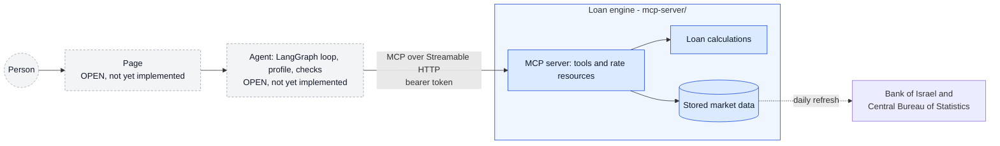

# loan-simulator

The loan simulator will be a Hebrew-only AI agent that helps a person decide on a short- or
medium-term loan (a car, a renovation, a consumer purchase): how much to borrow, how much savings
to keep, for how long, and on which track. The model will lead the conversation and decide what to
ask; code will compute every number and set the bounds the recommendation must respect. Each track
will be shown with what it costs today and what it would have cost had interest rates or inflation
moved as they did in the worst comparable period on record.

The full design is in
[docs/superpowers/specs/2026-10-26-loan-simulator-design.md](docs/superpowers/specs/2026-10-26-loan-simulator-design.md).
Today this repo holds the first of its three parts, the loan engine. The agent and the page are
OPEN, not yet implemented.

**Contents:** [Architecture](#architecture) · [The loan engine](#the-loan-engine) ·
[Scripts](#scripts) · [Testing](#testing) · [License](#license)

## Architecture



The model will choose what to ask and which tool to call; the engine returns the numbers and the
bounds. The engine knows nothing about people and stores nothing personal: it takes a profile and
loans and returns results. Details: [docs/architecture.md](docs/architecture.md); every formula
and policy number with its reasoning: [docs/calculations.md](docs/calculations.md); the market
data sources and what happens when one is down: [docs/market-data.md](docs/market-data.md).

**Stack:** Python, the MCP SDK, uvicorn, Docker.

## The loan engine

`mcp-server/` is a standalone Python MCP server of loan calculations over market data.

**Tools**

| Tool | Returns |
|---|---|
| `assess_affordability` | A monthly payment ceiling and a minimum savings cushion from a profile, with reason codes. |
| `size_loan` | The loan amount for a goal price, trade-in, savings and cushion. |
| `simulate_loan` | A short text summary for the model; the full result, schedule included, as structured content. |
| `suggest_tracks` | A fixed and a prime track priced from the published average bank rate. |

**Resources:** `rates://boi/history`, `rates://cpi/history` and `rates://current`.

**Start it.** Requires Docker.

```bash
./scripts/init-env.sh      # creates .env with a generated 48-character bearer token
./scripts/start.sh         # builds the image, starts the engine, returns once it answers
```

Every setting is explained once, in [.env.example](.env.example). The engine fetches the Bank of
Israel rate and the consumer price index before it listens (the first start takes a few seconds
longer), keeps them in the `engine-data` volume, and refreshes them daily. It listens on
`http://127.0.0.1:<ENGINE_HOST_PORT>/mcp`, published on this machine's loopback interface only.
`ENGINE_HOST_PORT` is set in `.env` (8100 as shipped in `.env.example`) and must be free.

**Connect MCP Inspector.**

```bash
npx @modelcontextprotocol/inspector
```

In the Inspector page choose the transport type **Streamable HTTP**, set the URL to
`http://127.0.0.1:<ENGINE_HOST_PORT>/mcp`, and under Authentication paste the value of
`ENGINE_BEARER_TOKEN` from `.env` as the bearer token. Connect, then open Tools and call
`simulate_loan`. For a loan of 31,000 ₪ at prime + 2.9, 48 months, unlinked, send:

```json
{"tracks": [{"principal": "31000", "term_months": 48, "rate_kind": "prime",
             "prime_spread": "2.9", "cpi_linked": false, "method": "spitzer"}]}
```

The result's structured content gives today's payment, the peak recurring payment and total,
the balloon due for a balloon track, the worst historical window (the past run of months as long
as the term whose rate and inflation moves give the highest payment) with its start and end
months, the range across all such windows, the schedule, and the data dates the figures rest on:
the Bank of Israel rate of today and the consumer price index of last month or the month before.
Its text content is a short summary of the same figures without the schedule, sized for a
language model's context.

Stop it, follow its logs or see its status with `./scripts/docker-helper.sh --stop | --logs |
--ps`.

## Scripts

All live in `scripts/`; run with `--help` for full usage.

| Script | Purpose |
|---|---|
| `init-env.sh` | Create `.env` with a generated bearer token; `--force` overwrites an existing one. |
| `start.sh` | Build and start the engine in Docker, and return once it answers. |
| `docker-helper.sh` | Stop (`--stop`, `--volumes` also removes the stored market data), follow logs, or show status. |
| `lock.sh` | Recompile `mcp-server/requirements.txt` inside the Dockerfile's Python image. |
| `test.sh` | The engine's checks: script syntax, lint, types, import layers, tests. |

## Testing

```bash
./scripts/test.sh          # every target; today the engine
./scripts/test.sh engine   # lint, types, import layers, tests
```

What each layer proves: [docs/testing.md](docs/testing.md).

## License

Released under the MIT License. See [LICENSE](LICENSE).
