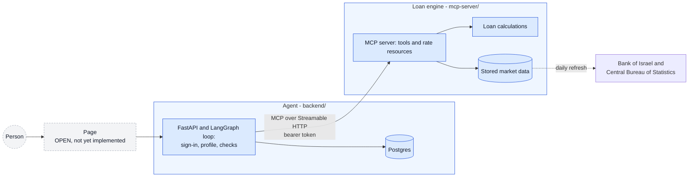

# loan-simulator

The loan simulator is a Hebrew-only AI agent that helps a person decide on a short- or
medium-term loan (a car, a renovation, a consumer purchase): how much to borrow, how much savings
to keep, for how long, and on which track. The model leads the conversation and decides what to
ask; code computes every number and sets the bounds the recommendation must respect. The engine
prices each track at what it costs today and at what it would have cost had interest rates or
inflation moved as they did in the worst comparable period on record; the page will show both.

This repo holds the loan engine and the agent. The page and the evals are OPEN, not yet
implemented.

**Contents:** [Architecture](#architecture) · [The loan engine](#the-loan-engine) ·
[The agent](#the-agent) · [Getting started](#getting-started) · [Scripts](#scripts) ·
[Testing](#testing) · [License](#license)

## Architecture



The model chooses what to ask and which tool to call; the engine returns the numbers and the
bounds. The engine knows nothing about people and stores nothing personal: it takes a profile and
loans and returns results. Details: [docs/architecture.md](docs/architecture.md); every formula
and policy number with its reasoning: [docs/calculations.md](docs/calculations.md); the market
data sources and what happens when one is down: [docs/market-data.md](docs/market-data.md).

**Stack:** Python, the MCP SDK, LangGraph, FastAPI, SQLAlchemy and Alembic, Postgres, uvicorn,
Docker.

## The loan engine

`mcp-server/` is a standalone Python MCP server of loan calculations over market data.

**Tools**

| Tool | Returns |
|---|---|
| `assess_affordability` | A monthly payment ceiling and a minimum savings cushion from a profile, with reason codes. |
| `size_loan` | The loan amount for a goal price, trade-in, savings and cushion. |
| `simulate_loan` | A short text summary for the model; the full result, schedule included, as structured content. |
| `suggest_tracks` | A fixed and a prime track priced from the published average bank rate. |

**Resources:** `rates://boi/history`, `rates://cpi/history` and `rates://current`.

**Market data.** The engine fetches the Bank of Israel rate and the consumer price index before it
listens (the first start takes a few seconds longer), keeps them in the `engine-data` volume, and
refreshes them daily.

## The agent

`backend/` is a FastAPI service that leads a Hebrew conversation with a language model, calls the
engine's tools and its own, and keeps each person's profile, checks, options and recommendation in
Postgres. People sign in with Google ([docs/sign-in.md](docs/sign-in.md)); sign-in is restricted
by the OAuth app's list of test users. The model never produces a figure: every number comes from
a tool result, and `present_recommendation` refuses an option that borrows less than the loan the
engine sized or whose worst-case payment is above the ceiling. A reply streams to the page as it
is written, and a person may send `AGENT_TURN_LIMIT` messages per `AGENT_TURN_WINDOW_HOURS`
(50 per 24 hours as shipped). The loop, the tools, the events and what happens on failure:
[docs/architecture/agent.md](docs/architecture/agent.md).

## Getting started

Requires Docker.

```bash
./scripts/init-env.sh      # creates .env with a generated bearer token and database password
# fill in LLM_MODEL, LLM_API_KEY and GOOGLE_CLIENT_ID in .env (docs/sign-in.md)
./scripts/start.sh         # builds the images, starts Postgres, the migration, the engine and
                           # the agent, and returns once the agent answers
```

Every setting is explained once, in [.env.example](.env.example). The agent refuses to start while
`LLM_MODEL`, `LLM_API_KEY` or `GOOGLE_CLIENT_ID` is blank. Stop the stack, follow its logs or see
its status with `./scripts/docker-helper.sh --stop | --logs | --ps` (`--stop --volumes` also
removes the stored market data and the database).

**Addresses.** Each service has a port inside the Compose network, where the services reach each
other by name, and a port published on this machine's loopback interface only, where you reach
it. As shipped in `.env.example`:

| Service | On this machine | Inside the Compose network |
|---|---|---|
| Agent | `http://localhost:8101` (`AGENT_HOST_PORT`): `/health`, `/ready`, `/api` | `agent:8000` (`AGENT_PORT`) |
| Engine | `http://localhost:8100/mcp` (`ENGINE_HOST_PORT`), for MCP Inspector | `engine:8020` (`ENGINE_PORT`) |
| Postgres | `127.0.0.1:8102` (`DB_HOST_PORT`), for an agent or a psql run on the host | `db:5432` (`DB_PORT`) |

A published port must be free on this machine; change it in `.env` if it is not. Open the agent as
`localhost`, the origin Google sign-in is registered for; a new `AGENT_HOST_PORT` needs the same
change in the Google client's origin ([docs/sign-in.md](docs/sign-in.md)).

### Try the engine with MCP Inspector

```bash
npx @modelcontextprotocol/inspector
```

The command opens Inspector in the browser.

1. Add a server (or edit the HTTP one Inspector lists) with the transport **streamable-http** and
   the URL `http://localhost:<ENGINE_HOST_PORT>/mcp`.
2. In the server's **Settings**, under **Custom Headers**, add the header `Authorization` with
   the value `Bearer ` followed by `ENGINE_BEARER_TOKEN` from `.env`. Leave the OAuth settings
   empty: the engine takes this one fixed token.
3. Connect with the server's toggle, open **Tools** and pick `simulate_loan`. Its one argument,
   `loan`, takes the tracks of the loan; switch on **Edit as JSON** to paste them. For a loan of
   31,000 ₪ at prime + 2.9, 48 months, unlinked:

   ```json
   {"tracks": [{"principal": "31000", "term_months": 48, "rate_kind": "prime",
                "prime_spread": "2.9", "cpi_linked": false, "method": "spitzer"}]}
   ```

The result's structured content gives today's payment, the peak recurring payment and total,
the balloon due for a balloon track, the worst historical window (the past run of months as long
as the term whose rate and inflation moves give the highest payment) with its start and end
months, the range across all such windows, the schedule, and the data dates the figures rest on:
the Bank of Israel rate of today and the consumer price index of last month or the month before.
Its text content is a short summary of the same figures without the schedule, sized for a
language model's context.

## Scripts

All live in `scripts/`; run with `--help` for full usage.

| Script | Purpose |
|---|---|
| `init-env.sh` | Create `.env` with a generated bearer token and database password; `--force` overwrites an existing one. |
| `start.sh` | Build and start Postgres, the migration, the engine and the agent in Docker, and return once they answer. |
| `docker-helper.sh` | Stop (`--stop`, `--volumes` also removes the market data and the database), follow logs, or show status. |
| `sql-helper.sh` | Run psql against the stack's database: a shell, `-c`, a SQL file, or row counts (`--counts`) and rows (`--rows`) of every table. |
| `lock.sh` | Recompile `mcp-server/requirements.txt` and `backend/requirements.txt` inside each Dockerfile's Python image. |
| `test.sh` | Script syntax, lint, types, import layers and tests, for the engine and the backend. |

## Testing

```bash
./scripts/test.sh          # every target: the engine and the backend
./scripts/test.sh engine   # lint, types, import layers, tests
./scripts/test.sh backend  # the same for the agent; its database tests need Docker
```

What each layer proves: [docs/testing.md](docs/testing.md).

## License

Released under the MIT License. See [LICENSE](LICENSE).
