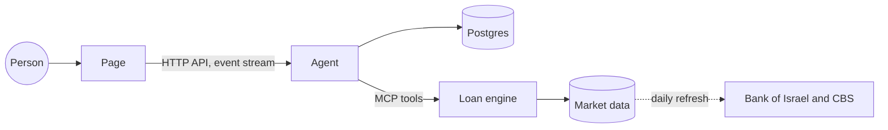

# loan-simulator

The loan simulator is a Hebrew-only AI agent that helps a person in Israel decide on a short- or
medium-term loan (a car, a renovation, a consumer purchase): for how long, and on which track (one
part of a loan with its own rate: fixed or tied to the prime rate, linked to the consumer price
index or not). The person states the loan they need and sees it simulated within the first turns;
their household finances come up only if they ask for help with a monthly payment ceiling. The model
leads the conversation and decides what to ask; code computes every number and sets the bounds the
recommendation must respect. The engine prices each track at what it costs today and at what it
would have cost had interest rates and inflation moved as in the worst stretch of the last ten
years; the page shows both. Access is by invitation, and the stack runs on one machine under Docker
Compose. This repo holds the loan engine, the agent and the page.

**Contents:** [Overview](#overview) · [Tech stack](#tech-stack) · [Architecture](#architecture) ·
[Getting started](#getting-started) · [Scripts](#scripts) · [Details](#details) ·
[License](#license)

## Overview

- **Sign-in and chat**: a person signs in with a Google account and chats with the assistant in
  Hebrew, on a right-to-left page. Only the Google accounts the operator lists as test users of
  the app's Google client can sign in.
- **The loan first**: the person writes the amount they need, or a price and the money they put
  in, with a purpose if they like. The assistant proposes a term with its first payment (with
  a stated monthly limit, the shortest term that fits it; otherwise 60 months for a car, or the
  shortest term whose first payment is under 1,000 ₪, up to 84 months), which the person
  confirms, changes, or replaces with a monthly limit, and then compares two example tracks, a fixed
  and a prime one, or the real offers the person collected and entered in a short form.
- **An optional payment ceiling**: the person may state the highest monthly payment that suits
  them, or ask for help, and the engine derives one from their net income and fixed expenses.
  These figures belong to the check and show as one line above its conversation once given. A
  check can be paused to collect offers and resumed days later, cloned to try a variant beside it,
  archived, restored, and deleted once archived.
- **Worst case**: every option shows today's payment and its worst-case payment: the highest
  payment had rates and inflation moved as in any stretch of past months as long as the loan's
  term, starting in the last ten years, and which stretch that was.
- **Recommendation**: a card with the loan amount, term and payment, each option's worst case,
  and the ceiling when there is one. Every figure on it comes from the engine's results, never
  from the model's text. The amount recommended is always the amount the person asked for.
  Without a ceiling the card says the recommendation is not yet checked against what the person
  can pay; with one, a guardrail in code refuses an option whose worst case is above it, and the
  assistant offers a longer term or names the largest loan that fits.
- **Message limit**: each person may send 20 messages per 24 hours as shipped; the operator can
  set another limit for a person by email.
- **Market data**: refreshed daily from public sources: the Bank of Israel rate and its average
  rate on new consumer loans, and the consumer price index of the Central Bureau of Statistics
  (CBS).

## Tech stack

- **Loan engine** — a Python MCP server (MCP SDK 2.x) over Streamable HTTP, with pure `Decimal`
  loan calculations
- **Agent** — Python, FastAPI on uvicorn, LangGraph with the engine's tools through
  `langchain-mcp-adapters`; Anthropic or OpenAI, chosen by one setting, `LLM_MODEL`
- **Storage** — Postgres 16 through SQLAlchemy and Alembic, with the LangGraph checkpoints; the
  engine keeps its market data in a Docker volume
- **Page** — React and TypeScript built with Vite, served by the agent
- **Auth** — Google sign-in, the ID token checked with PyJWT; a bearer token between agent and
  engine
- **Runtime** — Docker Compose: Postgres, a migration run, the engine and the agent, on the
  workstation or on one EC2 instance behind CloudFront (CloudFormation)
- **Tests** — pytest with Testcontainers, ruff, mypy and import-linter; Vitest and oxlint for the
  page; GitHub Actions runs every target

## Architecture

The page talks to the agent over an HTTP API and an event stream. The agent runs the
conversation as a LangGraph loop, keeps each person's checks in Postgres, and calls the loan
engine's tools over MCP. The engine knows nothing about people: it takes loans, and two monthly
figures for the ceiling, returns numbers and bounds, and refreshes its market data daily from the
Bank of Israel and the Central Bureau of Statistics.

**[Architecture](docs/architecture.md)** continues from here: the full diagram, the engine's
tools and layers, the agent, the page, the configuration and the Compose services.

## Getting started

Needs Docker; the tests also need Python 3.12+ and Node.js 22.

1. Create a Google OAuth web client in a Google Cloud project of your own, with
   `http://localhost:8101` as its authorized origin and `http://localhost:8101/` as its redirect
   URI, and add your Google account as a test user ([Sign-in](docs/sign-in.md) walks the
   console).
2. Run `./scripts/deploy.sh`. The first run creates the gitignored settings files under
   `scripts/lib/` from their `.example.sh` files, which explain each setting, with a generated
   bearer token and database password, then stops and names each setting left to fill in:
   `LLM_MODEL` as `provider:model` (`anthropic` or `openai`) and the client id as
   `GOOGLE_CLIENT_ID` in `params.sh`, and that provider's `LLM_API_KEY` in `secrets.sh`.
3. Fill them in and run `./scripts/deploy.sh` again. It builds the images, starts the stack and
   returns once the agent answers.
4. Open http://localhost:8101, sign in, and start a check.
5. To run the stack on AWS instead, on one EC2 instance behind CloudFront, run
   `./scripts/deploy.sh --ec2`. It also names the access key pair and region to fill in in
   `aws-config.sh`, and at the end prints the CloudFront address to add to the Google client
   ([Development & deployment](docs/development.md#deployment-scripts-scripts)).

The agent has no allow-list of its own: the test users of the Google client are the access
list, on this machine and on EC2 alike, for as long as the Google app stays in testing mode. A
published app would admit any Google account
([who may sign in](docs/sign-in.md#who-may-sign-in)).

To call the engine's tools by hand, run MCP Inspector (`npx @modelcontextprotocol/inspector`, a
browser tool for MCP servers) against http://localhost:8100/mcp with the header
`Authorization: Bearer <ENGINE_BEARER_TOKEN>` from `secrets.sh`. `./scripts/test.sh` runs every
test target. [Development & deployment](docs/development.md) has the addresses, the Inspector
walk-through and the tests.

## Scripts

- `init-env.sh` — creates the gitignored settings files under `scripts/lib/`, with a generated
  bearer token and database password; `deploy.sh` runs it first
- `test.sh` — the checks and tests of the engine, the agent and the page
- `deploy.sh` — builds and starts Postgres, the engine and the agent in Docker; `--ec2` does it
  on one EC2 instance behind CloudFront
- `docker-helper.sh` — stops the stack, follows its logs or shows its status

Each script's header comment is its full documentation, and `--help` prints it.

## Details

- [Architecture](docs/architecture.md) — the parts, the engine's tools, configuration and
  deployment
- [The agent](docs/architecture/agent.md) — how a conversation runs, the guardrail, the message
  cap and the events
- [The page](docs/architecture/page.md) — the layout, the data flow and how the page is served
- [Calculations](docs/calculations.md) — every formula and policy number, with its reasoning
- [Market data](docs/market-data.md) — the published series and what happens when one is down
- [Sign-in](docs/sign-in.md) — how sign-in works and how to set up the Google side
- [Development & deployment](docs/development.md) — the settings files, the tests, the
  scripts, the addresses and MCP Inspector
- [Testing](docs/testing.md) — what each test layer proves
- [Decisions](docs/adr/) — one record per founding decision: the engine, the worst case, the
  agent, storage, sign-in, the model setting, Compose, the page, EC2, and the loan-first flow

## License

Source-available under the [PolyForm Noncommercial License 1.0.0](LICENSE). Reading the source,
forking it and running a private deployment are free for anyone, companies included:
[NOTICE](NOTICE) grants that explicitly for evaluating the project or its author. Building a
commercial product or service on it needs a commercial license: erancha@gmail.com.
