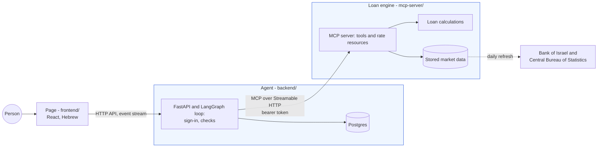

# Architecture

This document details the architecture the [README](../README.md) summarizes: the Compose
services the stack runs, the loan engine, the agent and the page, how the stack is reached on
EC2, where the data lives and how the code is laid out. Each section is a summary that links the
topic document holding the detail; each founding decision has a record under [adr/](adr/).
How to run the stack is in [Development & deployment](development.md), and how each part is
tested in [Testing](testing.md).

**Contents:** [The parts](#the-parts) · [The loan engine](#the-loan-engine) ·
[The agent](#the-agent) · [The page](#the-page) · [Configuration](#configuration) ·
[The edge](#the-edge) · [Host or guest on EC2](#host-or-guest-on-ec2) · [Storage](#storage) ·
[Codebase structure](#codebase-structure)

The model chooses what to ask and which tool to call; the engine returns the numbers and the
bounds. The engine knows nothing about people and stores nothing personal: it takes loans, and
for the payment ceiling two monthly figures, and returns results.

## The parts

Each part is a service of `docker-compose.yml`, and the whole stack runs on one machine, the
workstation or one EC2 instance ([ADR 0007](adr/0007-docker-compose-on-one-machine.md)). Every
route a service answers is in [API endpoints](api.md), the work no request waits on in
[Workers' responsibilities and flows](workers.md).

- `engine` — the loan engine's MCP server, built from the repo root with `mcp-server/Dockerfile`.
  The `engine-data` volume is mounted at `/data` and holds the stored market data across
  restarts; a daily refresh keeps it current.
- `db` — Postgres 16 with the `db-data` volume and a `pg_isready` healthcheck.
- `migrate` — a one-shot schema migration from the agent image.
- `agent` — the HTTP API, the event stream and the page, built from the repo root with
  `backend/Dockerfile`. It starts after `db` is healthy, `migrate` has completed and `engine` is
  healthy (it accepts connections, which is after its market data fetch); its healthcheck calls
  `/health`. Its conversation turns run as background tasks in its own memory.

## The loan engine

An MCP server that takes loans and returns numbers. It stores nothing personal and receives no
sign-in credentials: the person's Google token stays with the agent ([sign-in.md](sign-in.md)).
The engine is a service of its own so that every figure comes from code that any MCP client, MCP
Inspector included, can call
([ADR 0001](adr/0001-loan-engine-is-a-standalone-mcp-server.md)). Its tools and resources are in
[API endpoints](api.md#loan-engine-mcp-server-engine-service), its formulas and policy numbers
in [Domain rules](domain-rules.md), and the published series it prices over in
[Market data](market-data.md).

A worst case replays every stretch of past months as long as the loan's term that starts in the
last ten years, so it names a period a borrower recalls
([ADR 0002](adr/0002-worst-case-is-a-ten-year-historical-replay.md));
[Domain rules](domain-rules.md#historical-replay) has the replay.

## The agent

A FastAPI service in `backend/`, package `loan_agent`, that runs each check's conversation as a
LangGraph loop checkpointed to Postgres. The model leads the conversation instead of following a
scripted flow, at a higher cost per conversation
([ADR 0003](adr/0003-model-led-agent-with-a-code-guardrail.md)). A check starts from the loan the
person states, and the payment ceiling, the only household figure, is optional
([ADR 0010](adr/0010-loan-first-with-an-optional-ceiling.md)). An offer described in words is
read in code: the model extracts its figures, the engine prices each loan they may mean, and the
quoted payment decides between them ([ADR 0011](adr/0011-a-vague-offer-is-read-in-code.md)).
The chat model is whichever provider `LLM_MODEL` names, so the model changes without a code change
([ADR 0006](adr/0006-model-provider-is-a-setting.md)). People sign in with a Google ID token that
the agent verifies on every request and never passes on
([ADR 0005](adr/0005-google-id-token-sign-in.md), [Sign-in](sign-in.md)), and any Google account
may sign in ([ADR 0015](adr/0015-any-google-account-can-sign-in.md)).

Why the agent is built here, how a conversation runs, the guardrail, the turn cap and the events
are in [architecture/agent.md](architecture/agent.md).

## The page

A React app in `frontend/` that the agent serves from the same origin as its API. It holds no
data the agent does not hold: one event stream per open check feeds a reducer, and
the conversation and the recommendation card render from the reducer's state. The layout, the
data flow, where each figure on the card comes from and how the build reaches the agent image are
in [architecture/page.md](architecture/page.md). Serving the page from the agent keeps page and API
on one origin, which the sign-in cookie needs ([ADR 0008](adr/0008-page-served-by-the-agent.md)).

## Configuration

Both services read their settings from environment variables, which the scripts export from three
files under `scripts/lib/` before they call Compose: the committed `stack-params.sh`, and the
gitignored `params.sh` (this deployment's own settings) and `secrets.sh`. Each container receives
only the keys it reads. The files, the keys and the tests that keep them in line are in
[Development & deployment](development.md#configuration).

## The edge

The edge is how a person reaches the stack on EC2: a CloudFront distribution whose `https`
address is the only way in ([ADR 0009](adr/0009-ec2-instance-behind-cloudfront.md)).
`./scripts/deploy.sh --ec2` runs the same Compose stack on the instance, which a CloudFormation
stack, `scripts/template-ec2.yaml`, holds with the distribution;
[The EC2 stack](development.md#the-ec2-stack) has the instance, what the instance's Compose file
changes and how images and settings reach it.

## Host or guest on EC2

The instance serves the other Docker Compose repos too: one stack is its host, with the instance
its own, and the others join it as guests, each with its own port and CloudFront distribution
([ADR 0014](adr/0014-any-docker-repo-can-host-the-instance.md)). A preview of the working tree
runs beside production as one more guest, with its own address, Compose project and database, so
a change is tried on the real host, and production's next schema migration rehearsed on a copy of
its data, before production runs it ([ADR 0013](adr/0013-a-preview-runs-beside-production.md),
[The preview on EC2](development.md#the-preview-on-ec2)).

## Storage

Every table, its keys and what it holds are in [Data model](data-model.md).

- **Postgres** (the `db` service, volume `db-data`) holds the agent's tables beside LangGraph's
  checkpoint tables ([ADR 0004](adr/0004-one-postgres-for-records-and-checkpoints.md)).
- **Market data** is one JSON file in the engine's `engine-data` volume.
- **The page** keeps only browser conveniences, in `sessionStorage` and `localStorage`.

## Codebase structure

Each Python package is in layers whose imports point inwards
([Design patterns](design-patterns.md#layers-whose-imports-point-inwards)).

- `mcp-server/` — the loan engine: `src/loan_engine/` in `domain`, `market` and `service` layers,
  its tests and Dockerfile.
- `backend/` — the agent: `src/loan_agent/` in `domain`, `ports`, `application`, `adapters` and
  `platform` layers, `alembic/` migrations, its tests and the Dockerfile that also builds the page.
- `frontend/` — the page: `src/` with `api/`, `auth/`, `shell/`, `check/` and `demo/`, and its
  Vitest tests beside the components.
- `scripts/` — the operational scripts and `common.sh`, which they share ([Development &
  deployment](development.md#deployment-scripts-scripts)).
- `docs/` — this document, the topic documents, `architecture/` for the agent and the page, and
  `adr/`.
- `.github/workflows/` — the CI workflow that runs every target of `scripts/test.sh`.
