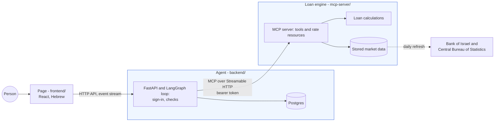

# Architecture

This document details how the loan simulator is built, behind the [README](../README.md)'s
Architecture section. How to run it is in [development.md](development.md). Formulas and policy
numbers are in [calculations.md](calculations.md), the market data in
[market-data.md](market-data.md), the agent in [architecture/agent.md](architecture/agent.md),
the page in [architecture/page.md](architecture/page.md), sign-in in [sign-in.md](sign-in.md),
and how each part is tested in [testing.md](testing.md). Each founding decision has a record
under [adr/](adr/).

**Contents:** [Parts](#parts) · [The loan engine](#the-loan-engine) · [The agent](#the-agent) ·
[The page](#the-page) · [Configuration](#configuration) · [Deployment](#deployment) ·
[Storage](#storage) · [Codebase](#codebase)

## Parts

The model chooses what to ask and which tool to call; the engine returns the numbers and the
bounds. The engine knows nothing about people and stores nothing personal: it takes loans, and
for the payment ceiling two monthly figures, and returns results.

## The loan engine

An MCP server that takes loans and returns numbers. It stores nothing personal and receives no
sign-in credentials. It serves Streamable HTTP at `/mcp`, stateless, with JSON responses. The agent
is its only caller, and the person's Google token stays with the agent ([sign-in.md](sign-in.md)).
The engine is a service of its own so that every figure comes from code that any MCP client, MCP
Inspector included, can call ([ADR 0001](adr/0001-loan-engine-is-a-standalone-mcp-server.md)).

One package, `loan_engine`, in layers whose imports point inwards only, enforced by
import-linter:

- `domain` holds the loan model, schedules, the historical replay, the term and loan searches
  (`policy`) and the loans a vaguely worded offer may mean (`readings`) as pure calculations. The
  household ceiling formula sits apart in `affordability`, and an import-linter contract keeps
  `policy`, `history`, `schedule` and `readings` from importing it, so no loan figure depends on
  the person's finances. Money is `Decimal`; values leave the server
  rounded to agorot.
- `market` fetches the Bank of Israel rate, the consumer price index and the Bank of Israel average
  consumer-loan rate, aligns them into a monthly history and keeps the last good copy on disk.
- `service` is the MCP server, configuration, the bearer-token check and startup.

The tools:

| Tool | Returns |
|---|---|
| `simulate_loan` | A short text summary for the model; the full result, schedule included, as structured content. |
| `suggest_tracks` | A fixed and a prime track priced from the published average bank rate, and a pension fund's fixed track linked to the CPI. |
| `market_series` | Today's prime and, for the latest months, the prime and the CPI's monthly change. |
| `propose_term` | The shortest term, in 6-month steps, at which both suggested tracks' first payment is below a limit, else 84 months, with that first payment. |
| `propose_offer_term` | The same search for one real offer, up to the longest term it allows. |
| `shortest_comfortable_term` | The shortest term, in 6-month steps up to 84, at which every suggested track's worst-case payment is at or below a ceiling, or with `any_track` at least one; null when none is. |
| `shortest_comfortable_offer_term` | The same search for one real offer, up to the longest term it allows. |
| `largest_comfortable_loan` | The largest loan, in whole thousands of shekels, on which at least one suggested track's worst-case payment fits a ceiling at a given term; null when none does. |
| `assess_affordability` | The payment ceiling from net fixed income and fixed expenses, with the two caps it is the lower of and reason codes. |
| `offer_readings` | The one-track loans an offer may mean, from the number it states or from its monthly payment alone, each with its first payment and today's total rate, and the fixed rate the payment amounts to. |

The model calls the first three; the agent's own check code calls the rest, `offer_readings`
among them, so the term card, the ceiling, the reading of a vague offer and the guardrail's
remedies come from code rather than from the model's choice of tool
([architecture/agent.md](architecture/agent.md#tools)).

**Resources:** `rates://boi/history`, `rates://cpi/history` and `rates://current`.

A worst case replays every stretch of past months as long as the loan's term that starts in the
last ten years, so it names a period a borrower recalls
([ADR 0002](adr/0002-worst-case-is-a-ten-year-historical-replay.md));
[calculations.md](calculations.md) has the replay.

Startup refreshes the market data once, then serves and refreshes daily side by side. With no
fetchable data and none stored, or when a daily refresh raises, the process exits with the error
rather than serving without data.

## The agent

A FastAPI service in `backend/`, package `loan_agent`, in layers whose imports point inwards only,
enforced by import-linter: `platform → application → ports → domain`, with `adapters`
implementing the ports and never importing `application` or `platform`.

- `domain` holds the check (with its loan, term, ceiling and finances), option, awaiting offer,
  reading and recommendation types and the errors; it imports no framework.
- `ports` are the protocols the inner layers call: the engine, the repositories, the event sink
  and bus, token verification.
- `application` holds the agent graph (the only inner-layer module that imports `langgraph`
  and `langchain_core`), the check tools with the guardrail, the choice between the readings of
  an offer described in words (`application/offer_reading.py`), and the event sink.
- `adapters` implement the ports: the engine client over MCP, Google token verification, Postgres
  repositories, the in-memory event bus and the chat model.
- `platform` is the HTTP API, configuration, logging, the checkpointer, the check runner and the
  composition in `app.py`.

The agent is built here rather than as a hosted assistant (a custom GPT, a Claude project)
because a person saves several options, compares them, and pauses a check to collect offers and
resumes it days later: state the app must own. LangGraph gives the loop that state: the
conversation is a graph whose state is checkpointed to Postgres after every step, so a check
resumes after a restart and a failed turn leaves the conversation where it was. The model leads
the conversation instead of following a scripted flow, at a higher cost per conversation
([ADR 0003](adr/0003-model-led-agent-with-a-code-guardrail.md)). A check starts from the loan the
person states, and the payment ceiling, the only household figure, is optional
([ADR 0010](adr/0010-loan-first-with-an-optional-ceiling.md)). An offer described in words is
read in code: the model extracts its figures, the engine prices each loan they may mean, and the
quoted payment decides between them ([ADR 0011](adr/0011-a-vague-offer-is-read-in-code.md)).
The chat model is whichever provider `LLM_MODEL` names, so the model changes without a code change
([ADR 0006](adr/0006-model-provider-is-a-setting.md)). People sign in with a Google ID token that
the agent verifies on every request and never passes on
([ADR 0005](adr/0005-google-id-token-sign-in.md)).

How a conversation runs, the guardrail, the turn cap and the events are in
[architecture/agent.md](architecture/agent.md).

## The page

A React app in `frontend/` that the agent serves from the same origin as its API. It holds no
data the agent does not hold: one event stream per open check feeds a reducer, and
the conversation and the recommendation card render from the reducer's state. The layout, the
data flow, where each figure on the card comes from and how the build reaches the agent image are
in [architecture/page.md](architecture/page.md). Serving the page from the agent keeps page and API
on one origin, which the sign-in cookie needs ([ADR 0008](adr/0008-page-served-by-the-agent.md)).

## Configuration

Settings come from environment variables, which the scripts export from three files under
`scripts/lib/` before they call Compose: the committed `stack-params.sh`, and the gitignored
`params.sh` (this deployment's own settings) and `secrets.sh`. The engine's keys are
`ENGINE_`-prefixed, the agent's are not. Compose hands each container only the keys
it reads, listed once per service in `docker-compose.yml`, so the engine never receives the
agent's model key or database password. An agent started on the host from the repo root reads
the same files. A missing or malformed required setting stops startup, and a blank value counts
as missing. Each key is explained once, in `stack-params.sh` or in the `.example.sh` beside a
gitignored file; `mcp-server/tests/test_settings_files.py` and
`backend/tests/test_settings_files.py` fail when the files and the settings differ, each owning
its service's keys, and each service's `test_compose.py` fails when its container receives a key it
does not read. `ENGINE_BEARER_TOKEN` is defined once and read by both services.

## Deployment

The whole stack runs on one machine under Docker Compose
([ADR 0007](adr/0007-docker-compose-on-one-machine.md)); the agent runs as one replica, because
turns in flight live in its memory. `docker-compose.yml` runs these services:

- `engine`, built from the repo root with `mcp-server/Dockerfile`. The `engine-data` volume is
  mounted at `/data` and holds the stored market data across restarts. The Host header allow-list
  (`ENGINE_ALLOWED_HOSTS`) must name every Host value the engine answers.
- `db`, Postgres 16 with the `db-data` volume and a `pg_isready` healthcheck.
- `migrate`, a one-shot run of `alembic upgrade head` from the agent image, after `db` is healthy.
- `agent`, built from the repo root with `backend/Dockerfile`, after `db` is healthy, `migrate` has
  completed and `engine` is healthy (it accepts connections, which is after its market data
  fetch). Compose overrides `DATABASE_URL` and `ENGINE_URL` with the in-network addresses
  (`db:<DB_PORT>`, `engine:<ENGINE_PORT>`); the settings files hold the host forms. Its
  healthcheck calls `/health`. A Node stage of its Dockerfile builds `frontend/` into the image,
  and the agent serves the result at `/`.

Three ports are published, each on `127.0.0.1` only through its variable of `stack-params.sh`
(the reason is in the header of `docker-compose.yml`; `backend/tests/test_compose.py` checks
it): `ENGINE_HOST_PORT` for MCP Inspector, `AGENT_HOST_PORT` for the agent's API and
`DB_HOST_PORT` for Postgres, 8100 to 8102 as shipped. `./scripts/deploy.sh` brings the stack up
and returns once the engine and the agent answer.

`./scripts/deploy.sh --ec2` runs the same Compose stack on one EC2 instance
([ADR 0009](adr/0009-ec2-instance-behind-cloudfront.md)). A CloudFormation stack,
`scripts/template-ec2.yaml`, holds the instance (ARM, with only the Docker engine), its
fixed address, a security group and a CloudFront distribution, whose `https` address is the only
way in: the security group admits the agent's port from CloudFront's servers alone, and port 22
from the deployer's address. TLS ends at CloudFront, and the hop to the instance is plain HTTP.
`docker-compose.ec2.yml` holds what differs on the instance: images built for ARM, the agent
published on the instance's address, and services that start again with the instance. The
images are built on the deployer's machine and loaded into the instance's Docker daemon over
SSH, and Compose runs on that machine against the daemon. The settings files stay on that
machine, and no secret store is involved: each container's own settings, secrets included,
reach the instance as part of its configuration, which Docker keeps on the instance's encrypted
disk. That disk holds the database and outlives the instance.

The instance can serve the other Docker Compose repos too. Any of their stacks can be its host,
with the instance its own, and the others join it as guests, each with its own port and
CloudFront distribution; `EC2_HOST_STACK` of `params.sh` names a guest's host
([ADR 0014](adr/0014-any-docker-repo-can-host-the-instance.md)).

A preview of the working tree runs beside production on the same instance (`deploy.sh --ec2
--preview`): a guest stack on production's instance, like the other repos' stacks, with its own
CloudFront address, Compose project and database, so a change is tried on the real host, and
production's next schema migration rehearsed on a copy of its data, before production runs it
([ADR 0013](adr/0013-a-preview-runs-beside-production.md)).

## Storage

- **Postgres** (the `db` service, volume `db-data`) holds the agent's tables, `checks`,
  `options`, `awaiting_offers`, `recommendations`, `check_events` and `deleted_event_times`, beside
  LangGraph's checkpoint tables. Alembic migrates the agent's tables, and the same `migrate` run
  brings the checkpoint tables to the installed library's version
  ([ADR 0004](adr/0004-one-postgres-for-records-and-checkpoints.md)). What each table holds is in
  [architecture/agent.md](architecture/agent.md#storage).
- **Market data** is one JSON file, `/data/market.json` in the engine's `engine-data` volume,
  written to a temporary file and renamed over the old one
  ([market-data.md](market-data.md#storage)).
- **The page** keeps only browser conveniences: the sign-in nonce in the tab's `sessionStorage`,
  and in `localStorage` the card's width and the day the person last tapped the market-data
  sample.

## Codebase

| Directory | Holds |
|---|---|
| `mcp-server/` | The loan engine: `src/loan_engine/` in `domain`, `market` and `service` layers, its tests and Dockerfile. |
| `backend/` | The agent: `src/loan_agent/` in `domain`, `ports`, `application`, `adapters` and `platform` layers, `alembic/` migrations, its tests and the Dockerfile that also builds the page. |
| `frontend/` | The page: `src/` with `api/`, `auth/`, `shell/`, `check/` and `demo/`, and its Vitest tests beside the components. |
| `scripts/` | The operational scripts and `common.sh`, which they share ([Development & deployment](development.md#deployment-scripts-scripts)). |
| `docs/` | This document, the topic documents, `architecture/` for the agent and the page, and `adr/`. |
| `.github/workflows/` | The CI workflow that runs every target of `scripts/test.sh`. |
