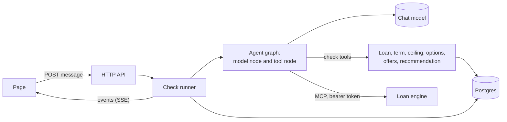

# The agent

How the loan agent runs a conversation, and why. It is the `loan_agent` package in `backend/`; the
layers and the other parts are in [the architecture map](../architecture.md), the sign-in in
[sign-in.md](../sign-in.md). The page that renders the conversation is described in
[page.md](page.md).

**Contents:** [The loop](#the-loop) · [Tools](#tools) · [The guardrail](#the-guardrail) ·
[Turns and the turn cap](#turns-and-the-turn-cap) · [Events](#events) ·
[Failure and restart](#failure-and-restart) · [Storage](#storage)

## The loop

A check is one conversation, and the conversation is one LangGraph thread, the unit of state the
graph checkpoints and resumes, named by the check's id. The graph loops between two nodes. The
model node sends the Hebrew system prompt (`application/prompts/system_he.md`) and the thread's
messages to the chat model, which either answers or asks for tool calls; the tool node runs the
calls and appends their results; the loop repeats until the model answers without a tool call,
puts a question on the person's screen with `ask`, `ask_term` or `ask_offer`, or has `read_offer`
put an offer's readings, or the line that its type was not recognized, on the screen as every
result of its calls. A refused question goes back to the model like any other tool error, and so
does an identified offer, which the model compares and recommends on. A reply whose tool calls
hold a NUL character in an argument never reaches the tool node: every call of it is answered
with a refusal and the model sends them again, because Postgres stores no NUL and a tool that
saved one would end the turn. A reply with a NUL in its text is discarded and written again once,
for the same reason. A prompt the provider's usage filter flags, which it does to ordinary loan
conversations now and then, is sent once more before the turn fails. The system prompt fixes
the agent's manner (Hebrew only, plain terms, a calm tone, every question through `ask`,
`ask_term` or `ask_offer`) and the arc of the conversation, which starts from the loan and goes
to the offers:

1. The opening card on the page gives the loan's purpose and amount. The runner saves them as the
   loan and shows the term card, with no model call. A loan the person writes in the chat, as an
   amount or as a price and the own capital put in, the model saves itself; the loan is the price
   less the own capital, and neither is stored.
2. The term card shows a first calculation of a term with its first payment and the assumption
   it rests on, in one form with the payment ceiling beside it; the person confirms the term in
   the form, or sets a ceiling alone, which brings a new card worked out from it. A check with no option, example or offer, and no awaiting offer
   answers the confirmed term with the offer form, with no model call. Any other check gets a
   model turn: one that holds only examples has them made again at the term; one with offers
   recommends on the saved ones, since the open ones were priced again at the term, or says in
   one line that the recommendation waits for the lender when every offer awaits.
3. Offers, entered in the form or described in words. A complete offer in words is saved with
   `save_offer`, one that lacks a detail opens the form filled in with what was said, and one
   that quotes a monthly payment or leaves its type open goes to `read_offer` (below). The
   form's skip is answered, with no model call, by an invitation to describe the offer in words.
4. A recommendation over the saved offers. The three example tracks (fixed and prime on the
   published average rate, and a pension fund's fixed track linked to the CPI) and a
   recommendation on them are made only when the person asks for them
   while the check has no offer; a request once an offer is saved or awaiting gets one line
   saying the check compares real offers, and one before the term is confirmed gets the term
   card first.
5. Only when the check has no payment ceiling yet, one question: the highest monthly payment that
   suits the person. The runner, not the model, asks it, at the end of the first turn that leaves
   the check with a recommendation and no ceiling, once per check (a clone keeps its source's
   asking), and records it in the conversation so the model reads the reply as the answer. They
   give a number, skip, or choose "don't know", which opens a help path:
   net fixed income and fixed expenses, from which the engine derives the ceiling. The ceiling
   is optional: a skip of either figure ends the path, and the recommendation stands without a
   ceiling until the person comes back to it. The term
   card's "תכנון החזר חודשי" chip opens the same path. When an earlier check of the person holds
   both figures, the model first offers to reuse them.
6. A pause for the person to collect more offers, and a comparison once they are in.

A monthly payment the person volunteers at any step becomes the ceiling, and the ceiling question
is not asked; a monthly payment inside a lender's offer is the offer's own figure and goes to
`read_offer`, never to the ceiling. The model never asks a financial figure before the person
has seen their loan simulated, unless they ask for help. It is guidance for the model, not a script.

Every model call also carries a second system message, built from the stores at that moment
(`application/turn_state.py`): the loan or "none yet", the confirmed term, the payment ceiling
and its source (`stated` or `finances`), the check's two figures or "not told" with the ones
still missing, the figures of the person's latest other check that holds both, how many real
offers and examples the check holds (`option_counts`), the saved options (`offers`: each with its
source, lender, track, term, first payment, total and price), the offers awaiting their lender
(`awaiting_offers`: each with its id, lender, monthly payment, the kinds of its readings and the
likely one), and whether the recommendation is `none`, `unchecked` or `checked`, marked "of one
option alone" when its card holds a single option. The prompt mentions examples, and how many,
only from `option_counts`, so a reply never counts examples a check does not hold. The awaiting
offer's id is what lets a later message about it ("קבוע") reach that
offer rather than describe a new one. The model therefore sees what the person saved on the page
without a tool call, and the block never enters the checkpoint.

The model chooses what to ask and which tool to call. It never produces a figure: the prompt
tells it that every amount, rate or payment it says comes from a tool result of that
conversation, and the page shows figures from stored tool results. The prompt likewise limits
what the model offers the person to what one of its tools does: it does not offer to approach a
lender, to produce a file or to send anything, and it asks a yes or no question with the two
answers as `choices`, since the page draws a free question without choices as a text box.

Of the inner layers, only `application/agent_graph.py` imports `langgraph` and `langchain_core`.
The chat model is built from `LLM_MODEL` (`provider:model`, anthropic or openai) and
`LLM_API_KEY`. The graph runs on a Postgres checkpointer, so a conversation resumes from its last
checkpoint after a restart. The person and the check come from the run configuration, never from
the model's arguments, so the model can act only on the check it is talking about.

Every model call of a turn, and every turn of a check, repeats the tools, the system prompt and
the conversation so far. Anthropic requests mark them for the provider's prompt cache
(`adapters/chat_model.py`), so each call pays for the new messages only; OpenAI caches long
prefixes unasked.

## Tools

The model sees two sets of tools. An agent tool's result is a compact `key: value` summary.

| Source | Tool | Does |
|---|---|---|
| Engine | `simulate_loan` | Cost and worst-case figures of a loan. |
| Engine | `market_series` | Today's prime and the latest months of the prime and of the CPI's monthly change. |
| Agent | `set_loan` | Saves the loan: its amount and an optional purpose, and a payment ceiling the person named in the same message, saved as stated before the term card proposes a term. Refuses an empty purpose, a ceiling of 0 or less, an amount of 0 or less, and an amount outside the principal limits the engine prices, naming them. When the check's recommendation is for another amount, its result tells the model to save options of the new amount and recommend again. |
| Agent | `ask_term` | Puts the term card on the person's screen. Without a term it proposes one (below); with a number of months, it shows that term's first payment, and marks the card as the recommendation's suggested shorter term when the number is that term, as the person's typed term otherwise. Refuses a term outside 6 to 84 months, a check with no loan, and the term the last card already showed, which the person's answer confirms, so the model calls `set_term` instead of showing the same card again. |
| Agent | `ask_offer` | Puts the offer form on the person's screen, with the lender, tracks and longest term the person already said filled in, when a message about a real offer lacks one of them. Refuses a check with no loan, and an offer that lacks none of them, which `save_offer` saves: the form would ask the person again for what they said. |
| Agent | `read_offer` | Reads an offer described in words that quotes a monthly payment or leaves its type open, from only what the person said: the lender, the amount and months the lender quoted, the number stated, the payment and the type words (פריים, קבוע, צמוד). The engine's `offer_readings` prices each loan the words may mean on the quoted amount and term, and `application/offer_reading.py` decides (below): an identified reading is saved as a real offer on the check's loan amount and goes back to the model to recommend on, unless the quoted amount is below the check's loan, when it is stored as awaiting the lender's answer on the amount; an offer left open is stored as awaiting its lender, with the readings its card shows, which removes the check's examples; an unrecognized one saves nothing. With an awaiting offer's id it adds the new detail to that offer and decides again, and it refuses describing an awaiting offer anew, naming its id. It also refuses a check with no loan, a missing lender, an unknown term, and an offer with neither a number nor a payment, which goes to the form instead. |
| Agent | (runner) | `POST /api/checks/{id}/opening`, from the opening card, saves its purpose and amount as the loan through `set_loan` before the line is stored, so a refused loan answers 422 with its reason and records nothing, then shows the term card through `ask_term` with no model call. A check that already holds a loan is refused. |
| Agent | (runner) | `POST /api/checks/{id}/term-confirmation`, the line of a term the page saved through `PUT /api/checks/{id}/term`: a check with no option, example or offer, and no awaiting offer gets the empty offer form through `ask_offer` with no model call; any other check gets a model turn, which makes the examples again at the term when the check holds only examples, or recommends on its offers. |
| Agent | (runner) | `POST /api/checks/{id}/offer-skip`, the offer form's skip, answered with a fixed Hebrew line inviting the person to describe the offer or offers in their own words, with no model call. |
| Agent | `answer_offer_amount` | The lender's answer, told in the chat, on an awaiting offer quoted for less than the check's loan: with `covers` it saves the offer's reading (the one it holds, or the one named) on the check's loan amount at the quoted term and goes back to the model to recommend; without it the offer leaves the check with an `offer.dropped` and the model says in one line what comes next. Refuses an unknown id, an offer quoted for the loan amount or more, and a yes on an offer whose type is still open between several readings without naming one. |
| Agent | (runner) | `PUT /api/checks/{id}/awaiting-offers/{awaiting_id}/amount`, the lender's answer on the card of an offer quoted for less than the check's loan (`covers`, and the chosen `reading`): saves the offer on the loan amount or drops it, before the page sends "אישור: <loan> באותם תנאים אצל <lender>, <reading>" or "לא: אין הצעה של <lender> על <loan>", the line the model answers. It answers 404, 409 and 422 as the reading confirmation does, and 422 for an offer with no amount question. |
| Agent | (runner) | `PUT /api/checks/{id}/awaiting-offers/{awaiting_id}`, the reading the person confirms on an awaiting offer's card, saves that reading as a real offer and removes the awaiting offer, before the page sends the line "אישור: <reading>" that the model recommends on. It answers 404 for an offer the check does not hold, 409 while a turn runs or on an archived check, and 422 for a reading the offer lacks or an offer quoted for less than the check's loan, which is answered through its amount question. |
| Agent | (runner) | `POST /api/checks/{id}/offer-sample`, where the page sends the offer chip's sentence, tapped or typed, once the check has a loan, shows the empty offer form through `ask_offer` with no model call, and records in the conversation that the form is on the screen. |
| Agent | (runner) | `POST /api/checks/{id}/term-ceiling`, from the term card's ceiling box, saves the ceiling as stated through `set_ceiling` and shows a new card through `ask_term` with no term, with no model call, and records both in the conversation. |
| Agent | `set_term` | Saves a term the person typed in the conversation with no card open. A term confirmed on the card is saved by the page through `PUT /api/checks/{id}/term`, which runs the same tool code and saves a ceiling typed beside it as stated, before the line "אישור: N חודשים" reaches the model. Either way it prices every offer that leaves its term open again at the new term, up to the offer's maximum, before saving anything, and names those offers in its result. |
| Agent | `set_ceiling` | Saves the monthly payment the person stated as the ceiling, replacing any ceiling the check held. Refuses 0 or less. |
| Agent | `update_finances` | Saves net fixed income or fixed expenses on this check; once both are known, the engine's `assess_affordability` derives the ceiling, which replaces any ceiling the check held. |
| Agent | `ask` | Puts one question on the person's screen: a loan, ceiling or finances field, the offer to clone the check, or free text with two or more optional choices, under an optional Hebrew lead-in. Refuses a field the check already holds, the clone offer while the check has no recommendation, an English word in the text the person would see, and every question of a model message that asks more than one. |
| Agent | `save_examples` | Saves the example tracks for the check's loan amount and term in one call: it asks the engine's `suggest_tracks` for them (a fixed and a prime track priced from the published average rate, and a pension fund's fixed track linked to the CPI), simulates each and saves all of them as options, or none. The model takes no part in choosing them, so the check never holds some of the examples. An example already saved with the same figures is kept in place of saving it again. Refuses a check with no confirmed term, and any example once the check holds a real offer of its loan amount or an offer awaiting its lender. Its result names each example's track and compares it with each saved option of the same term, classing each gap: a first-payment gap under 2% of the larger is "זניח" and not mentioned; a total-cost gap under 3% is "במקצת" and worded so, since the total still decides; anything larger is "ברור". The classes are Hebrew because the model quotes them. |
| Agent | `save_offer` | Saves a real offer with every track it names in one call, refusing a track listed twice. A lender's tracks are alternatives for the whole loan amount, so each is simulated and saved as an option of its own; every track is priced before any is saved, so a refusal of one, which names the track, saves none. It refuses a track whose principal is not the check's loan amount, an offer already saved with the same lender, date, maximum and figures, naming it, and a track saved with `max_term_months` at any term but the check's confirmed term, or the maximum when that is shorter; before a term is confirmed, the one the engine's offer search gives for that track (below). The maximum is stored with each option, so a later term change can price it again. Its result gives each track's option and comparisons as `save_examples` does, and tells the model to recommend again. |
| Agent | `show_chart` | Fetches the prime or the CPI's monthly change for the latest months from the engine and puts it in the conversation as a chart. |
| Agent | `present_recommendation` | Saves a preferred option and an optional alternative as the recommendation, through the guardrail. |

The model gets only the engine's three loan tools (`MODEL_ENGINE_TOOLS` in
`adapters/engine_mcp.py`). The term searches, the largest loan, the ceiling formula and the
readings of an offer are engine tools too, but only the check tools call them, so the rule behind
a proposed term, a derived ceiling, an offer's reading or a remedy is fixed in code rather than
left to the model's choice of tool:

- **The proposed term.** With a ceiling, any purpose gets `shortest_comfortable_term`: the
  shortest term at which both unlinked example tracks' worst-case payments fit the ceiling, else 84
  months, since a limit the person knows decides the term. Without one, any purpose gets
  `propose_term`: the shortest term in 6-month steps whose first payment on both unlinked example
  tracks is under the assumed 1,000 ₪, else 84 months. The card's question carries this basis
  (the rule, its amount and whether the term fits it), so the card states the assumption. The
  pension fund example is left out of both searches: few lenders offer a linked loan.
- **An offer that leaves the term open** ("up to 84 months") is priced at the check's confirmed
  term, or at its maximum when that is shorter, since a lender's term is a limit, not a fixed
  number; the card notes an offer held at its maximum. When the term changes, in the check or in
  its clone, `set_term` prices every such offer again. An offer saved before any term is
  confirmed takes the shortest term its own track allows, by the same two rules:
  `propose_offer_term` without a ceiling, `shortest_comfortable_offer_term` with one, else the
  offer's longest term.
- **The derived ceiling.** `update_finances`, and `PUT /api/checks/{id}/finances` from the page's
  figures panel, save through one function (`application/finances_saving.py`), which calls
  `assess_affordability` before it stores anything, so stored figures always come with the
  ceiling they give. The ceiling given last, stated or derived, wins.
- **The reading of an offer in words.** The model only extracts figures; the readings, their
  first payments and the choice between them come from code. When the offer states a number and
  quotes a payment, a reading fits when its first payment is within 1% of the quoted payment;
  exactly one fit identifies the offer, whatever its type words say, several fits go to the
  person's card, and no fit means the type was not recognized. An offer with only a number or
  only a payment always goes to the card. On a card, "פריים" keeps only the prime readings when it
  has some, and "צמוד", else "קבוע", marks the linked, else the unlinked fixed reading as likely.
  The readings and the fit rule are in [calculations.md](../calculations.md#reading-an-offer). An
  awaiting offer is left out of every recommendation until the person confirms one of its
  readings, because a reading that is a guess must not be compared as if certain. An offer quoted
  for less than the check's loan awaits even when identified, until the lender says whether it
  lends the loan amount on the same terms, because the check compares single loans of its amount
  and a lender who quoted less may not lend it.

A change of the ceiling or of the figures, while the check holds a recommendation, comes back
with a `next_step` telling the model to recommend again in the same turn, so the card is checked
against the new ceiling. The page sends a line in the person's name for a figure saved on the
panel, so the model explains the new ceiling in the chat.

The engine's tools are listed from the running engine at startup, so the agent follows the
engine's schemas. An engine tool returns its result twice: as text, which is all the model's
context receives, and as structured content, kept as the tool message's artifact, which goes to
the page in the `option.saved` event and never reaches the model. For `simulate_loan` the text is
a short summary and the structured content also holds the month-by-month schedule; for the other
tools the text is the result as JSON. Money is a decimal string in both directions.

A tool that refuses (a missing field, an unknown option id, the guardrail) raises an error whose
message tells the model what is wrong and what to do next, and the model reads it as the tool's
result and corrects the call.

## The guardrail

`present_recommendation` is the only way to make a recommendation. It reads the loan and the
ceiling from the stored check rather than trusting figures the model passes. The amount the
person asked for is the amount recommended: nothing sizes it. It refuses when:

- the check has no loan yet;
- a named option, preferred or alternative, borrows another amount than the check's loan;
- a named option is an example of another term than the check's. Offers count at any term,
  since saving the term prices an open offer at it;
- the check has a ceiling, a named option's worst-case recurring payment, from the replay of
  history, is above it, and a saved option for the check's term fits. Fits means at or below the
  full ceiling, with no safety margin, and each option is judged on its own. A balloon is paid
  once at the end, so it is not a recurring payment;
- the preferred option is an example while a real offer of the loan amount exists that fits the
  ceiling, or any such offer while the check has no ceiling: an example is an average nobody can
  take;
- another option of the preferred one's source and term fits the ceiling, or the check has none,
  and costs less in total, unless `person_preference` carries what the person said that makes the
  dearer one suit them. The refusal names the cheapest such option.

A refusal for an option above the ceiling says which argument to change. When the preferred
option is above it, the refusal names the saved options for the term that fit. When only the
alternative is, it says the preferred option stands and to call again without the alternative, or
with one that fits. When
none fits, the term is the person's to keep, so the recommendation is presented and the card marks
it above the ceiling. Its result names the remedy the model offers the person once: the shortest
term up to 84 months at which an unlinked example track fits, with the tracks that do and their
worst-case payments; else the largest loan that fits at the confirmed term (`largest_comfortable_loan`, at 84
months while no term is confirmed), with the question whether to borrow less or put in more own
capital; else that no loan the simulator prices fits. The result tells the model to change neither
the amount nor the term until the person chooses, and that a kept term leaves the recommendation
standing.

A presented recommendation's result gives the preferred and the alternative option's term and
figures as they stand, `preferred_figures` and `alternative_figures`, and the reply quotes only
those, so it never repeats figures from before a term change. An option whose payment never
changes has no worst period in history: its figures say `payment_changes never` in place of the
three historical figures, so the model has no period to describe. With a ceiling, it also gives
`preferred_ceiling_margin` and `alternative_ceiling_margin`: how far each option's worst-case
payment is below the ceiling, in shekels and as a share of it, so the reply states the distance
beside that payment, in numbers the model did not compute. When the preferred
option's term may move (an example, or an offer that leaves its term open), the engine's offer
search finds the shortest term at which its track still fits; a shorter one comes back as a
`next_step` with its worst-case payment and the interest it saves, telling the model to end the
turn with the term card for it (`ask_term`), where the person confirms it or keeps their term. The
card states those figures, not the reply: showing a card ends the turn, so a sentence about them
would only be written a turn late, after the term changed. A term confirmed before the ceiling was
known is otherwise never revisited.

The result also gives each named option's price, `preferred_price` and `alternative_price`, as
[calculations](../calculations.md#the-price-of-an-offer) defines it: its interest cost over the
principal and its rate today against the average bank rate on consumer loans, or on top of the
CPI for a linked loan. `save_offer` gives the same price with each saved track. The prompt has
the reply state the interest cost wherever it states a real offer's payment, and never call a
payment low or good only because it is under the ceiling: the ceiling says the person can carry
it, not that the loan is a good one.

When the recommendation's card holds one option alone, nothing is ranked, so the result adds
`only_option`: the model presents it as the only offer so far, never as preferred or recommended,
under the heading **ההצעה שבדקתי** in place of **ההמלצה שלי**, with its price, and suggests getting
another offer to compare. "One option alone" is `compares_options` in `domain/models.py`: the
options the card shows, those the recommendation names and every other one for the check's term,
number one. The checks list's chip and the page's card labels follow the same rule.

Without a ceiling the recommendation is on the loans' merits: the cheapest in total paid, unless
the person stated a preference another option suits better. Within
those rules the model may argue for any option on the person's stated preferences. A
recommendation is stored with the loan amount and the ceiling it was checked against, or none, so
it reads as checked or unchecked; the `recommendation.presented` event says which. An error from
the engine itself during this step ends the turn as a failure rather than reaching the model,
since after the agent's own validation it means a broken invariant.

The model can write a recommendation as text and skip the tools, which saves nothing and leaves the
card unchanged. So the model node reads each reply before it enters the conversation: a reply with
the recommendation section, or the single offer's section in its place, and no successful
`present_recommendation` in this turn is discarded and
the model is told once to redo it. The second reply stands, because a reply about a case with no
recommendation may share the heading. A discarded reply is only ever streamed live, never stored.

The person reads Hebrew only, while the prompt and the tools' results name tools and fields in
English; the words a reply may quote, such as a gap's class, are Hebrew in the results. One
pattern, two Latin letters in a row, guards every text the person sees. A reply with a match
the person did not write themselves, such as a lender's name, is discarded and rewritten once in
the same way, and the words are logged as a warning with the check's id. The runner stops
streaming such a reply at the word and sends `message.retracted`, so the page drops it. `ask`
and `present_recommendation` refuse a question, a choice, a lead-in or a reasoning with a match,
so the model calls again in Hebrew.

## Turns and the turn cap

A person's message starts a turn: `POST /api/checks/{id}/messages` stores the message and
answers 202, and the turn runs as a background task, so the reply arrives on the event stream. A
check has at most one turn in flight (a message during a turn answers 409); turns on different
checks run concurrently. Turns live in the process's memory, so the agent runs as one replica.

The page's market-data sample ("פריים ומדדים") goes to `POST /api/checks/{id}/market-sample`
instead, when the person sends it as given, apart from spacing and a closing period, question mark
or exclamation mark. Its turn makes no model call: `application/market_answer.py` reads 60 months of
the prime and 12 of the CPI's monthly change from the engine and writes one line on each (the prime
as of the data's date, its range and how many times it changed between months; the CPI's total
change and its monthly range), followed by the two charts. The data changes only when the Bank of
Israel moves its rate or a month's CPI is published, so a model would only reword the same figures.
The exchange is appended to the check's conversation, so a follow-up question reaches the model with
it. It counts as a message, under the same guards as one, as do the runner's other replies
written without the model: the opening card, a confirmed term that brings the offer form, the
form's skip, the offer chip and a ceiling typed on the term card.

Every message costs model calls, so a person may send at most `AGENT_TURN_LIMIT` messages (20),
across all their checks, in any rolling window of `AGENT_TURN_WINDOW_HOURS` (24).
`AGENT_TURN_LIMIT_OVERRIDES` replaces that limit for the people it names, by lowercase email. Over
the cap the API answers 429 with the time of the next allowed message in the body and in
`Retry-After`. The count is read from the stored `message.user` events and from
`deleted_event_times`, so it survives restarts and deleting a check gives no messages back.

`DELETE /api/checks/{id}` removes a check's saved conversation, then, in one transaction, the
check, its options, its awaiting offers, its recommendation and its events. The conversation goes
first and lives in the checkpoint tables, so a failure between the two leaves a check that can be
deleted again. The check's finances go with it, since the check holds them. While the check runs a
turn the route answers 409. Only the times of messages still inside the cap's window stay, with no
text, in `deleted_event_times`; the next delete of any check removes those that have left the
window.

The cap counts messages, not model calls, so one turn is also bounded: it may take at most
`TURN_STEP_LIMIT` (40) graph steps (`application/agent_graph.py`), where a model call is one step
and the tool calls it asks for, run together, are one more. A first recommendation takes about 13.
A model that keeps calling tools past the limit ends the turn with `turn.failed`, like any other
failed turn. A model that asks for the same tool calls with the same arguments a third time in a
row (`SAME_CALLS_LIMIT` is 2) ends it the same way at once: a repeated call's result cannot differ,
so the model is stuck, and the turn does not pay for the same call up to the step limit.

## Events

Each check has an append-only event log in Postgres; the stream
`GET /api/checks/{id}/events` replays it and then follows live events as server-sent events. It
subscribes before it reads the log and skips duplicates by sequence number, so nothing between the
two is lost, and a reconnecting browser sends `Last-Event-ID` and gets only what follows. A
keepalive comment goes out every 15 seconds. The stream stays open when a turn ends, since the
person may send another message.

| Event | Meaning |
|---|---|
| `message.user` | The person's message. |
| `message.delta` | The reply's whole text so far while the model writes it. Live only, never stored. |
| `message.retracted` | A reply being written that showed an English word, which the page drops while the model rewrites it. Live only, never stored. |
| `message.assistant` | A complete model message with text, under the message id its fragments carry. |
| `loan.set`, `term.set` | A tool saved the loan or the confirmed term. |
| `ceiling.set` | The person stated a ceiling; carries it with the source `stated`. |
| `finances.updated` | A figure was saved; carries both figures, the ones missing, and the check's ceiling and its source after the save. |
| `question.asked` | The model asked one question, or put up the term card (kind `term`, with the term, its first payment and `basis`: how the term was chosen, `first_payment_target` or `ceiling` with the amount and whether the term fits it, `shorter` for the shorter term a recommendation suggested, with the ceiling, the term it shortens, the worst-case payment and the saving, or `typed`) or the offer form (kind `offer`, with what the person already said); the page renders it with a control. |
| `chart.shown` | A market series for the page to draw: which series, its date and its monthly values. |
| `check.cloned` | Left on the source check after a clone, naming the copy; the page adds a handoff note to the source's conversation, with a button to the copy, and the source stays open. A clone does not copy it. |
| `option.saved` | An option was saved; carries the engine's full result. |
| `offer.identified` | `read_offer` identified an offer and saved it: the option's id, the lender, the reading, today's prime and its date, the quoted payment, and the quoted and the check's loan amounts; the page shows the short reply that names the loan. |
| `offer.awaiting` | An offer awaits its lender's answer: its id, lender, quoted amount, term and payment, the rate the payment amounts to, the type words, the readings, the likely one, whether the quoted payment identified its one reading (only an offer quoted for less than the check's loan awaits so), and today's prime with its date; the page shows it as a readings card. Emitted again under the same id when a later message changes the offer. |
| `offer.unrecognized` | No reading fit the offer, so nothing was saved; carries the lender, and the page asks the person to get more details from the lender. |
| `offer.settled` | An awaiting offer became a saved offer: its id, the reading's kind and the reading it was saved by. Emitted both when the person confirms a reading on the card and when a later detail identifies the awaiting offer, whose reading the card may not hold; the page shows the saved reading on the settled card. |
| `offer.dropped` | An awaiting offer quoted for less than the check's loan left the check, since its lender does not lend the loan amount on the same terms: its id, the lender, and the quoted and the check's loan amounts; the page shows on its card that the offer does not cover the loan. |
| `recommendation.presented` | A recommendation passed the guardrail; carries the loan amount, the ceiling and its source or none, whether it was checked, both options and the reasoning. |
| `turn.status` | `running` when a turn starts, `idle` when it ends. |
| `turn.failed` | A Hebrew message the page shows as is, sent before `idle` when a turn failed. |

Fragments are never stored and go out without an event id, so a page that reconnects or opens a
check later replays complete messages only, and the browser's `Last-Event-ID` always names a
stored event. A fragment queued while the stream read the log is dropped when the replay already
sent its message complete, so a fragment never follows its complete message on the stream.

## Failure and restart

- A turn that raises is logged with its cause, never shown to the page: the log ends with
  `turn.failed` and `turn.status idle`, and the person may try again. The thread stays at its
  last checkpoint. If the failed turn ended inside the tool node, the next turn first answers the
  unfinished tool calls with a note that their outcome is unknown, since a model provider refuses
  a conversation with an unanswered tool call, and the model asks the person before repeating a
  call that saves something.
- At startup the runner ends every turn whose log stops at `running` and that no turn of this
  process runs: a stopped process left it, and nothing else would end it. It emits `turn.failed`
  and `idle` for each.
- Startup fails fast. The agent lists the engine's tools before it opens any database connection;
  an unreachable engine, or a missing or blank required setting, stops the process naming the
  cause. `/health` answers while the process runs; `/ready` also needs the database to answer.
- On SIGTERM open event streams end at once, so the server can stop within its short graceful
  timeout; turns in flight are cancelled and their threads stay at the last checkpoint.
- The agent logs structured lines to stderr at `AGENT_LOG_LEVEL` (WARNING as shipped). Access
  lines for `/health` and `/ready` answered below 400 go out at DEBUG, so an orchestrator's
  probes do not fill the log.

## Storage

One Postgres holds the agent's tables (checks, options, awaiting offers, recommendations, the
event log and the times kept from deleted checks) and the LangGraph checkpoint tables. The
`migrate` service applies both with `alembic upgrade head` before the agent starts. A check row
holds the loan, the confirmed term, the ceiling with its source, and the two finances figures;
there is no per-person record.
Checks and events carry the Google account's `sub` as their `user_id`; options, awaiting offers
and recommendations belong to a check. An `awaiting_offers` row, keyed by its check and its own
id, holds the lender and, as JSON, what the lender quoted (amount, term, stated number, payment),
the type words, the readings with the likely one, and the prime they were priced at; a later save
of the same offer replaces the row and keeps its first time, so the list keeps its order. A clone
copies its source's awaiting offers with its options and recommendation, and
`scripts/tools/sql/reset-people.sql` deletes them with the person's checks.
`./scripts/tools/sql-helper.sh --counts` lists the tables with their row counts.
