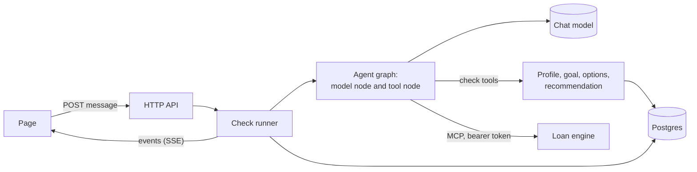

# The agent

How the loan agent runs a conversation, and why. It is the `loan_agent` package in `backend/`; the
layers and the other parts are in [the architecture map](../architecture.md), the sign-in in
[sign-in.md](../sign-in.md). The page that renders the conversation is described in
[page.md](page.md).

**Contents:** [The loop](#the-loop) · [Tools](#tools) · [The guardrail](#the-guardrail) ·
[Turns and the turn cap](#turns-and-the-turn-cap) · [Events](#events) ·
[Failure and restart](#failure-and-restart) · [Storage](#storage)

## The loop

A check is one conversation, and the conversation is one LangGraph thread, the unit of state the
graph checkpoints and resumes, named by the check's id.
The graph has two nodes. The model node sends the Hebrew system prompt
(`application/prompts/system_he.md`) and the thread's messages to the chat model, which either
answers or asks for tool calls; the tool node runs the calls and appends their results; the loop
repeats until the model answers without a tool call or puts a question on the person's screen
with `ask`. A refused `ask` goes back to the model like any other tool error. The system prompt
fixes the agent's manner (Hebrew only, plain terms, a calm tone, every question through `ask`) and
the arc of the conversation: profile, goal, a first recommendation on the published average rate,
a pause for the person to collect offers, real offers, and a comparison. It is guidance for the
model, not a script.

Every model call also carries a second system message, built from the stores at that moment
(`application/turn_state.py`): each profile field or "not told", the fields still missing, and the
goal or "none yet". The model therefore sees figures the person saved on the page without a tool
call, and the block never enters the checkpoint. The minimum of the variable income counts as
missing only while the variable income is not 0; when it is 0 the block and the `update_profile`
result show the minimum as "not needed", and `ask` refuses to ask for it. A profile refuses a
minimum above the variable income, naming both fields.

The model chooses what to ask and which tool to call. It never produces a figure: the prompt
tells it that every amount, rate or payment it says comes from a tool result of that
conversation, and the page shows figures from stored tool results.

Of the inner layers, only `application/agent_graph.py` imports `langgraph` and `langchain_core`.
The chat model is built from `LLM_MODEL` (`provider:model`, anthropic or openai) and
`LLM_API_KEY`. The graph runs on a Postgres checkpointer, so a conversation resumes from its last
checkpoint after a restart. The person and the check come from the run configuration, never from
the model's arguments, so the model can act only on the check it is talking about.

Every model call of a turn, and every turn of a check, repeats the tools, the system prompt and
the conversation so far. Anthropic requests mark them for the provider's prompt cache
(`adapters/chat_model.py`), so each call pays for the new messages only; OpenAI caches long
prefixes unasked.

## Tools

The model sees two sets of tools. An agent tool's result is a compact `key: value` summary.

| Source | Tool | Does |
|---|---|---|
| Engine | `assess_affordability` | Monthly payment ceiling and minimum savings cushion from the profile. |
| Engine | `size_loan` | Loan amount for the price, savings and cushion. |
| Engine | `simulate_loan` | Cost and worst-case figures of a loan. |
| Engine | `shortest_comfortable_term` | The shortest term, in 6-month steps, at which the suggested tracks' worst-case payment stays within 90% of the ceiling. |
| Engine | `shortest_comfortable_offer_term` | The same search for one real offer, up to the longest term it allows; the term to save it at. |
| Engine | `suggest_tracks` | A fixed and a prime track priced from the published average rate. |
| Engine | `market_series` | Today's prime and the latest months of the prime and of the CPI's monthly change. |
| Agent | `update_profile` | Saves the person's finances, as given. |
| Agent | `set_goal` | Saves the purpose and the price together. |
| Agent | `ask` | Puts one question on the person's screen: a profile or goal field, or free text with two or more optional choices, under an optional Hebrew lead-in. Refuses an empty question, a single choice, a profile field already saved, every `ask` of a model message that holds more than one, and the minimum-of-variable-income question when the variable income is 0. |
| Agent | `save_option` | Simulates a loan through the engine and saves it as an option. Its result for an offer, once the profile is complete, tells the model to recommend again. Refuses an example (`published_average`) until the whole profile is known, and one whose worst-case payment is above the ceiling. Refuses an offer saved with `max_term_months` at any term but the one `shortest_comfortable_offer_term` gives. |
| Agent | `show_chart` | Fetches the prime or the CPI's monthly change for the latest months from the engine and puts it in the conversation as a chart. |
| Agent | `present_recommendation` | Checks a preferred option and an optional alternative against the engine's bounds, saves the recommendation with the loan the preferred option takes and the cushion that leaves. Refuses an example preferred over a real offer within those bounds. |

The engine's tools are listed from the running engine at startup, so the agent follows the
engine's schemas. An engine tool returns its result twice: as text, which is all the model's
context receives, and as structured content, kept as the tool message's artifact, which goes to
the page in the `option.saved` event and never reaches the model. For `simulate_loan` the text is
a short summary and the structured content also holds the month-by-month schedule; for the other
tools the text is the result as JSON. Money is a decimal string in both directions.

A tool that refuses (a missing field, an unknown option id, the guardrail) raises an error whose
message tells the model what is wrong and what to do next, and the model reads it as the tool's
result and corrects the call.

## The guardrail

`present_recommendation` is the only way to make a recommendation, and it refuses unless the
recommendation stays within the engine's bounds. It recomputes the bounds itself from the stored
profile and goal (`assess_affordability`, then `size_loan`) rather than trusting figures the model
passes. It refuses when:

- the profile or the goal is incomplete (the message lists what to ask for);
- no loan is needed, because the savings cover the price while keeping the minimum cushion;
- an option borrows less than the loan the engine sized, since the gap would come out of the
  minimum cushion. When the sized loan is above the engine's maximum loan no option can pass, so
  the refusal tells the model to say the purchase is outside the range the simulator prices and
  to suggest a larger down payment or a cheaper goal; the system prompt says the same for a sized
  loan below the engine's minimum;
- an option's worst-case recurring payment, from the replay of history, is above the payment
  ceiling. A balloon is paid once at the end, so it is not a recurring payment.

Within those bounds the model may argue for any option on the person's stated preferences. A
recommendation that passes is stored with the figures the engine gave (loan amount, ceiling,
cushion) and the check snapshots the profile version it was computed on; editing the profile
afterwards marks the check stale until the agent recommends again. An error from the engine
itself during this step ends the turn as a failure rather than reaching the model, since after the
agent's own validation it means a broken invariant.

The model can write a recommendation as text and skip the tools, which saves nothing and leaves the
card unchanged. So the model node reads each reply before it enters the conversation: a reply with
the recommendation section and no successful `present_recommendation` in this turn is discarded and
the model is told once to redo it. The second reply stands, because a reply about a case with no
recommendation may share the heading. A discarded reply is only ever streamed live, never stored.

## Turns and the turn cap

A person's message starts a turn: `POST /api/checks/{id}/messages` stores the message and
answers 202, and the turn runs as a background task, so the reply arrives on the event stream. A
check has at most one turn in flight (a message during a turn answers 409); turns on different
checks run concurrently. Turns live in the process's memory, so the agent runs as one replica.

Every message costs model calls, so a person may send at most `AGENT_TURN_LIMIT` messages (20),
across all their checks, in any rolling window of `AGENT_TURN_WINDOW_HOURS` (24).
`AGENT_TURN_LIMIT_OVERRIDES` replaces that limit for the people it names, by lowercase email. Over
the cap the API answers 429 with the time of the next allowed message in the body and in
`Retry-After`. The count is read from the stored `message.user` events and from
`deleted_event_times`, so it survives restarts and deleting a check gives no messages back.

`DELETE /api/checks/{id}` removes a check's saved conversation, then, in one transaction, the
check, its options, its recommendation and its events. The conversation goes first and lives in
the checkpoint tables, so a failure between the two leaves a check that can be deleted again. The
profile stays, because all of a person's checks share it. While the check runs a turn the route
answers 409. Only the times of messages still inside the cap's window stay, with no text, in
`deleted_event_times`; the next delete of any check removes those that have left the window.

The cap counts messages, not model calls, so one turn is also bounded: it may take at most
`TURN_STEP_LIMIT` (40) graph steps (`application/agent_graph.py`), where a model call is one step
and the tool calls it asks for, run together, are one more. A first recommendation takes about 13.
A model that keeps calling tools past the limit ends the turn with `turn.failed`, like any other
failed turn.

## Events

Each check has an append-only event log in Postgres; the stream
`GET /api/checks/{id}/events` replays it and then follows live events as server-sent events. It
subscribes before it reads the log and skips duplicates by sequence number, so nothing between the
two is lost, and a reconnecting browser sends `Last-Event-ID` and gets only what follows. A
keepalive comment goes out every 15 seconds. The stream stays open when a turn ends, since the
person may send another message.

| Event | Meaning |
|---|---|
| `message.user` | The person's message. |
| `message.delta` | The reply's whole text so far while the model writes it. Live only, never stored. |
| `message.assistant` | A complete model message with text, under the message id its fragments carry. |
| `profile.updated`, `goal.set` | A tool saved the profile or the goal. |
| `question.asked` | The model asked one question; the page renders it with a control. |
| `chart.shown` | A market series for the page to draw: which series, its date and its monthly values. |
| `option.saved` | An option was saved; carries the engine's full result. |
| `recommendation.presented` | A recommendation passed the guardrail; carries the bounds, the sizing, both options and the reasoning. |
| `turn.status` | `running` when a turn starts, `idle` when it ends. |
| `turn.failed` | A Hebrew message the page shows as is, sent before `idle` when a turn failed. |

Fragments are never stored and go out without an event id, so a page that reconnects or opens a
check later replays complete messages only, and the browser's `Last-Event-ID` always names a
stored event. A fragment queued while the stream read the log is dropped when the replay already
sent its message complete, so a fragment never follows its complete message on the stream.

## Failure and restart

- A turn that raises is logged with its cause, never shown to the page: the log ends with
  `turn.failed` and `turn.status idle`, and the person may try again. The thread stays at its
  last checkpoint. If the failed turn ended inside the tool node, the next turn first answers the
  unfinished tool calls with a note that their outcome is unknown, since a model provider refuses
  a conversation with an unanswered tool call, and the model asks the person before repeating a
  call that saves something.
- At startup the runner ends every turn whose log stops at `running` and that no turn of this
  process runs: a stopped process left it, and nothing else would end it. It emits `turn.failed`
  and `idle` for each.
- Startup fails fast. The agent lists the engine's tools before it opens any database connection;
  an unreachable engine, or a missing or blank required setting, stops the process naming the
  cause. `/health` answers while the process runs; `/ready` also needs the database to answer.
- On SIGTERM open event streams end at once, so the server can stop within its short graceful
  timeout; turns in flight are cancelled and their threads stay at the last checkpoint.
- The agent logs structured lines to stderr at `AGENT_LOG_LEVEL` (WARNING as shipped). Access
  lines for `/health` and `/ready` answered below 400 go out at DEBUG, so an orchestrator's
  probes do not fill the log.

## Storage

One Postgres holds the agent's tables (profiles, checks, options, recommendations, the event log and
the times kept from deleted checks) and the LangGraph checkpoint tables. The `migrate` service
applies both with `alembic upgrade head` before the agent starts. Profiles, checks and events carry
the Google account's `sub` as their `user_id`; options and recommendations belong to a check.
`./scripts/tools/sql-helper.sh --counts` lists the tables with their row counts.
