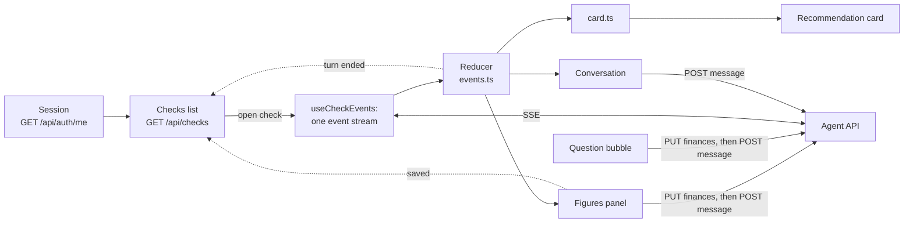

# The page

This document details the page that [Architecture](../architecture.md#the-page) summarizes: how
it shows a conversation and its recommendation, and how the agent serves it. It is the React app
in `frontend/`: Hebrew, right to left, in TypeScript, built with Vite. It reads the agent's HTTP
API ([the agent](agent.md)) and holds no data the agent does not hold; the sign-in is in
[sign-in.md](../sign-in.md).

**Contents:** [Layout](#layout) · [Data flow](#data-flow) ·
[The opening card and the chips](#the-opening-card-and-the-chips) ·
[The question bubble](#the-question-bubble) ·
[Offers described in words](#offers-described-in-words) · [The card](#the-card) ·
[Offers awaiting a lender](#offers-awaiting-a-lender) ·
[Refreshing the checks list](#refreshing-the-checks-list) ·
[Archiving and deleting a check](#archiving-and-deleting-a-check) · [Serving](#serving)

## Layout

A signed-out visitor sees the product name and the "התחברות עם Google" button
(`frontend/src/auth/`), which sends the browser to Google and receives the ID token back in the URL
fragment ([sign-in.md](../sign-in.md)). Under the name a line gives the build: its
version, which is the release tag the checkout descends from (`vMAJOR.MINOR`) and the commits since
it, and its last commit's date. `scripts/lib/build-info.sh` reads both from git and the image
build receives them as build arguments, since its context has no `.git`. Under the card, one
line of links opens the demo, whose label states its length in minutes and whose tooltip says it
is a recorded check best seen on a computer; a WhatsApp invite carrying the page's own address; and
the GitHub source.

A signed-in person sees a header whose account menu (`shell/AccountMenu.tsx`) names the account and
holds sign-out, and one open check. The open check is kept in the URL hash as `#check=<id>`; a hash
that names no check of theirs opens the newest one and is rewritten to match.

The demo, `/demo.html`, is the same app over a recorded check (`frontend/src/demo/`). Before the
app renders, it replaces `fetch` and `EventSource` with a backend that replays one check's stored
events on a timer. It types each reply out as deltas, since the server stores replies whole. Before
each message the person typed, it shows the typed value in its box for a second: an answer in its
question's box, any other message in the chat's composer. It answers the checks list from the
events played so far. A recorded clone names the last event it shares with its source, and the
demo rebuilds the source from those shared events and its clone note: once the replay passes the
clone, the list shows both, and the source opens on its whole conversation.
`sql-helper.sh --demo-check <id>` writes the recording from the stack's database.

A visitor may click anything in the demo, and no server is there to carry an action out. Every
request but a read counts as the visitor's action: the demo's banner (`demo/DemoBanner.tsx`) then
shows a notice that the action is unavailable in the demo, with a link into the simulator, and an
action the demo has no answer for never settles, so the page shows no failure of its own. The link
closes the demo's tab when the tab it was opened from still shows the simulator, which returns the
visitor there; otherwise it loads the simulator in the demo's tab. Until the replay ends, the
button that opens a new check is disabled, so a visitor is not led out of the recording midway.

From 900px wide the open check is three columns: the side column (the checks list), the
conversation, and the recommendation card. A check that holds a payment ceiling, stated or derived,
or a finances figure (its income or fixed expenses; the list's `has_finances` flag) has a "פרטים
כספיים" link on its entry's months row. Tapping it opens the check on its conversation with a
one-line summary above it: the two figures and the ceiling, marked "לפי מה שאמרת" when stated, with
an "עריכה" link that opens the two fields in place; tapping it again hides the summary, and every
check opens with it hidden. While the open check's term card takes an answer, the link and the
summary are both hidden, so the card is the one place the ceiling is set. The entry is a container
rather than one button, so the link is a button of its own: the entry's select button holds the
title, takes the entry's text as its name, and stretches its click area over the entry beneath the
link. The side column is 300px, so an entry's title fits its first line and its term its second. The
card starts at 470px; dragging the border between it and the conversation, or the arrow keys on that
border, narrows it to 380px or widens it up to what leaves the conversation 360px
(`check/CardResizer.tsx`), and the browser keeps the width. The conversation takes the rest. Below
900px a tab bar ("בדיקות", "שיחה", "המלצה") shows one of the three at a time
(`frontend/src/styles/global.css`). A sideways swipe moves to the next pane in Hebrew reading
order, a finger moving right bringing in the tab on the left, and wraps around from "המלצה" to
"בדיקות" (`shell/useTabSwipe.ts`). Scrolling wins: a mostly vertical move, a move that starts in
a text field or in something that scrolls sideways, such as a scenario's table, and one that
starts at a screen edge, where the phone has its own back gesture, switch nothing. Until the
check holds an option or an offer awaiting its lender, the recommendation pane has nothing to show,
so the "המלצה" tab is greyed and takes no tap, and a swipe passes over it.

The reply that presents the check's recommendation, the first finished one after it in its own
turn, carries a link under its bubble on every screen width: "השוואת המספרים בכרטיס: למה המספרים
האלה". It switches to the "המלצה" pane where there are tabs, then opens that table, scrolls it
into view and highlights it for a moment, since on a wide screen it sits low on the card beside
the chat.

## Data flow

The page asks for the session first. With a session it loads the checks list, newest first, and
opens one. `useCheckEvents` opens one event stream (`/api/checks/<id>/events`) for the open check
and closes it when another check opens. The stream replays the check's stored events and then
continues live; the browser reconnects by itself and the agent replays only what followed. The
reducer (`check/events.ts`) folds each event into one state: the messages, the options by id, the
latest recommendation, the loan, the confirmed term, the ceiling with its source, the check's two
finances figures, the offers awaiting their lender, and whether a turn is running. A
`question.asked` event becomes a question entry in the messages, and a `chart.shown` event a chart
entry, which `check/MarketChart.tsx` draws as a line (the prime) or as bars around zero (the CPI's
monthly change), with a hidden table of the values for screen readers. A `scenario.shown` event
becomes a scenario entry, which `check/ScenarioTable.tsx` draws as a table titled with the scenario
("אם המדד יעלה 5% בשנה והפריים לא ישתנה"), one row per option named as its card names it, with its
highest payment and its total, each today and then on the scenario. A scenario figure is red when
higher than today's, green when lower, and only "↔️" when it rounds to the same shekel. Amounts
never wrap; below 900px an option is named by its source alone, on one line cut with "…", with the
full track in the cell's title. A real offer's lender chip in the table is a button: a tap shows
the recommendation pane, scrolls that offer's card into view and outlines it for a moment
(`revealOption` in `check/RecommendationCard.tsx`); when the card does not show that offer, the
pane opens as it is. A question of kind `scenario` is the form `check/ScenarioForm.tsx` draws:
one box for the yearly rise of the movement offered, sent as "סימולציה: הפריים יעלה X% בשנה".
The `offer.*` events add an entry for an offer or mark its card settled, as [offers described in
words](#offers-described-in-words) describes. The question is live while it is the last entry and no
turn runs. Only the person's next message closes it; a running turn hides its controls until the
turn ends. A closed question stays in the conversation as text. Stored events carry a sequence
number and are applied once; a partial reply (`message.delta`) carries the whole reply so far and is
dropped when its complete message has already arrived, and `message.retracted` removes a partial
reply the assistant is rewriting. The conversation and the card both render from that state. A 401
on any call returns the page to sign-in. The browser retries a dropped stream by itself but closes
it for good on a response it will not retry; the page treats any such close, a 401 among them, as
signed out.

The figures belong to the check, so they come with its stream: each `finances.updated` carries
both figures and the ceiling after the save, and the figures panel (`check/FinancesPanel.tsx`)
renders from the reducer's state. It shows net fixed income and fixed expenses, each with its
hint, and the check's ceiling with its source when there is one. It starts closed, and only the
person opens it, so the conversation keeps the focus. A figure is saved when its field loses
focus, and a value equal to the stored one sends nothing. The save is
`PUT /api/checks/<id>/finances`, then the page posts "עודכן: <label> <value>" as the person's
own message, so the agent explains the ceiling the figures give. A refused save shows its message
under the field and sends nothing. While a turn runs, or once the check is archived, the fields
show but take no edit.

## The opening card and the chips

A check the person has not started, with nothing in its conversation, shows only the opening card
(`check/OpeningCard.tsx`), titled "פרטי ההלוואה": no chat box and no chips. It has two panels,
one per thing the person decides. The first asks for the goal, one tap among רכב, שיפוץ and כללי.
The second asks for the amount, through a switch between "סכום ההלוואה" (one box) and "מחיר והון
עצמי" (two boxes, with the loan they leave shown under them), with the boxes under the switch
they belong to. Each choice is a button as wide as its share of the row, filled when chosen; its
radio input stays in the page, out of sight, for the keyboard and screen readers. An amount box
groups its digits by thousands as the person types (`check/GroupedAmountInput.tsx`), keeping the
caret after the digit it followed. The card is as wide as the chat allows, up to 26rem. המשך judges
every box and marks a missing goal, an amount outside 10,000 to 10,000,000 ₪, or own capital that
covers the price, sending nothing. A valid card goes once to `POST /api/checks/<id>/opening` with
the goal, the amount as a decimal string and the line "רכב: הלוואה בסך 45,000 ₪"; the agent saves
the loan and answers with the term card. A refused loan shows the card's own Hebrew line and keeps
the card; any other failure shows the page's notice. Once the check has events, the conversation
and its chat box take the card's place.

The chat box is two rows tall when empty and grows with its text up to three, so a chip's
sentence shows whole on a phone; a longer text scrolls inside it.

Above the chat box sit up to six chips, in this order. "דוגמאות", "סימולציה", "החזר חודשי" and
"פריים ומדדים" fill the chat box with their sentence for the person to send as it is or change
first; the terms chips send theirs at once; "הצעה מגוף מלווה" opens the empty offer form at once,
while an offer in the person's own words goes through the chat box. A chip that sends at once
clears the chat box once its sentence is accepted, since it starts a step of its own. While the
offer form waits for an answer, "פריים ומדדים" is the only chip, so no chip puts a different
request in the chat box beside the form:

- "דוגמאות", while the check has a loan, a term, no option, example or offer, and no awaiting
  offer: its sentence goes to the model, which prices the example tracks.
- "קיצור תקופה" and "הארכת תקופה", once a recommendation names an option whose term can move, an
  example or an offer that leaves its term open (`termComparisons` in `check/events.ts`): the
  first while a term above 6 months remains, the second below the longest term the option's
  lender allows. The sentence goes to the model, which answers with the terms card.
- "הצעה מגוף מלווה", once the check has a loan and a term: a tap sends "קיבלתי הצעה להלוואה מגוף
  מלווה" to `POST /api/checks/<id>/offer-sample`, answered with the empty offer form and no model
  call. The same sentence typed by hand goes the same way; any other wording goes to the model.
- "סימולציה", once the check holds an option, example or offer: its sentence asks the model for
  a scenario table of every option, with the CPI and prime moving as over the last two years.
- "החזר חודשי", while the check has no ceiling: "ההחזר החודשי המקסימלי שלי הוא:", for the person
  to finish with the amount, which the model saves as the ceiling.
- "פריים ומדדים", always: the market-data question.

On the recommendation card the recommended option is labelled "מועדפת" and its alternative
"חלופה", and only when the card shows more than one option: a label ranks options against each
other, and one option alone is evaluated, not recommended. In the checks list, a check with a
recommendation has a green chip: "המלצה מוכנה" when the recommendation compares more than one
option, "הצעה נבדקה" when its card holds one real offer alone; or only the "דוגמא" chip while
the recommendation rests on examples, which nobody can take. Both follow one rule,
`comparesOptions` in `check/card.ts`, which the server mirrors as the checks list's
`compares_options` and the demo backend computes from the replayed events.

## The question bubble

When the model asks a question, `check/QuestionBubble.tsx` renders it as an assistant bubble with
the lead-in and the field's label. While the question is live it also shows a hint, a control fitted
to the field (a text box for an amount, tap choices for a purpose), a confirm button for typed
answers and a skip button. The ceiling question also has a "תכנון ההחזר" button, the term card's
words, which the agent takes as a request for help: it asks for the two finances figures
instead. Its skip goes to `POST /api/checks/<id>/unanswered`, which stores it and answers
nothing, so the person goes on in the chat as they choose. A question with choices of its own
(the purpose, a free question the model gave choices, or the clone offer) has no skip, since the
chat box takes any other answer and a skip only gets the question asked again. A closed question
shows only the text.

The term card is a question of its own kind, a calculation the person tunes: one line with the term
in months and its first payment ("48 חודשים · החזר מ-975 ₪"), titled "חישוב ראשוני" only when the
term was worked out from the simulator's own assumed payment, not from the person's ceiling or typed
term; a line on the assumption the term was worked out from, which the question's `basis` carries:
the assumed first payment of 1,000 ₪ when the check has no ceiling, or the check's ceiling, each
with the amount, or the term the person typed. Beside its אישור button, where the person looks
before confirming, a short note says the figures are a calculation, not an offer: "לא הצעה: חישוב
לפי הריבית הממוצעת להלוואות, 7.9% (בנק ישראל, 08/2026)", with the rate and month the question's
`market` carries from the engine's market data. The card of a shorter term a recommendation suggests
is titled "אפשר לקצר", and its line says the term is the best one under the ceiling, with the term
it shortens, the worst-case payment and what it saves in total, so a card the person did not ask for
explains itself. When even 84 months does not keep the payment under the check's ceiling, the line
says so plainly. When the person named no ceiling and 84 months cannot meet the assumed payment, the
line names no assumed amount, since the person never chose one: it states that 84 months is the
longest term and gives the lowest payment the loan allows, the card's first payment. A card stored
before the basis was sent shows the title alone. Then one form with two boxes and one "אישור"
button. The term box starts at the proposed term; the ceiling box starts at the check's payment
ceiling, or empty when it has none, and may stay empty. A ceiling derived from the finances shows
its calculation beside the box while the box holds it: the lower of the engine's two caps, as
`finances.updated` carries them, such as "(50% מההפרש בין הכנסה של 10,000 ₪ להוצאות של 6,500 ₪)".
While the check lacks a finances figure, an underlined link beside the ceiling box, "תכנון ההחזר",
sends those words and saves nothing; the agent takes them as a request for help with the ceiling, as
it does from the ceiling question. On אישור:

- A new ceiling with the term left as proposed goes with its line to
  `POST /api/checks/<id>/term-ceiling`; the agent saves it as the stated ceiling and answers with a
  card worked out from it, with no model call: the shortest term whose worst-case payment fits the
  ceiling, or 84 months.
- Anything else confirms the term in the box. The page saves it, with a new ceiling when there is
  one (`PUT /api/checks/<id>/term`), and sends "אישור: 48 חודשים", or "אישור: 48 חודשים, החזר
  חודשי מרבי: 1,000 ₪", to `POST /api/checks/<id>/term-confirmation`. A check with no offer is
  answered with the offer form and no model call; for one with offers the model reads both as
  set rather than judging the line, and recommends on its offers.

The terms card is a question of its own kind too: a table with the recommended option's own term
first and the next terms shorter or longer under it, each row with its payment today and the
highest the worst past window would have raised it to, marked in amber when that passes the
ceiling, with a line under the table saying what the mark means. While the card is live, the
first row is labelled "התקופה הנוכחית" and each other row has a "לבחור" button, which confirms
that term exactly as the term card's אישור does; a marked term stays a choice. A closed card
keeps its table without the buttons.

A term outside 6 to 84 months, or a ceiling the check holds cleared from its box, is refused in
the bubble. The card's own term typed in the chat ("60" or "60 חודשים") while the card is open
confirms it the same way; another number typed there goes to the model, which answers with a card
for it.

The offer form (`check/OfferForm.tsx`), titled "פרטי ההצעה", opens with a line inviting the person
to describe their offers there or in the chat, for the simulator to compare. It asks for the lender,
up to four tracks, each a margin over or under prime or a fixed rate, linked to the CPI or not, and
the longest term the lender allows; המשך sends the offer as one worded message, which the model
saves; the lender's name follows its own label ("הגוף המלווה: מקס"), and the agent refuses "גוף
מלווה" and its like as a name. A line under the boxes says the offer may be described in words in
the chat box instead, and the form has no skip. Its "אין לי עדיין הצעה" button answers the form with
that line, which `POST /api/checks/<id>/unanswered` stores with no reply. The line closes the form,
the chips return, and an arc sweeps the edges of the "דוגמאות" and "הצעה מגוף מלווה" chips for 4
seconds, so the person decides which way to go. The button shows only while "דוגמאות" is offered.

`check/CheckPage.tsx` handles the answer in this order. A typed answer to a finances field is
saved first (`PUT /api/checks/<id>/finances`), the checks list is refreshed, and then the
page-built line "<label>: <value>" is posted as the person's own message; a label that ends in
"?" takes its value after a space instead. A refused save shows its message in the bubble and
sends nothing. An answer to a loan or ceiling field or a free question posts the line alone, and
the agent saves it with its own tool. A skip posts "דילוג על: <label>" without a save. The
agent's side of the question is in [the agent](agent.md).

Money is never a JavaScript number. The API sends amounts as decimal strings, and
`frontend/src/money.ts` formats them from the text, rounding half up on the digits.

## Offers described in words

An offer the person describes in the chat comes back as one of three entries, each rendered from
its `offer.*` event:

- **Identified** (`check/OfferReplies.tsx`): a short reply that names the loan, how a prime
  reading's rate adds up ("ריבית הפריים נכון ל-15.11.2026 היא 4.75%, כך שהריבית הכוללת היום היא
  11.2% (4.75 + 6.45)"), and that the payment given matches; an offer quoted on more than
  the check's loan adds which amount the check prices. A "פריים ומדדים" chip in the reply
  fills the chat box as the chip above it does.
- **Not recognized**: one line asking the person to get more details from the lender, whether the
  loan is based on prime and whether it is a fixed rate linked to the CPI.
- **The readings card** (`check/ReadingsCard.tsx`), for an offer that awaits its lender: the rate
  the payment amounts to today, when a payment was given; what the lender's words suggest, when
  "קבוע" or "צמוד" was said, with the warning that lenders say "קבוע" also when only the rate is
  fixed; the question to ask the lender, boxed under a caption with a copy button; the readings as
  radio buttons, each with a half-line on how its payment behaves, the likely one chosen and
  tagged "הסביר ביותר"; then "אישור" and "המשך להצעה נוספת עד לבירור השאלה", a closing line that the
  person may keep entering offers and come back from the yellow bubble beside the check, and the
  "פריים ומדדים" chip.
- **The amount question**, on the readings card of an offer quoted for less than the check's
  loan: a line "ההצעה של מקס היא על 20,000 ₪, והבדיקה היא על 45,000 ₪.", and the question to the
  lender ends with "האם תוכלו להציע 45,000 ₪ באותם תנאים?". Its "כן, באותם תנאים" takes the place
  of אישור, beside "לא" and "המשך להצעה נוספת עד לבירור השאלה". An offer its payment identified
  shows that identification, as the identified reply words it, in place of the rate, the words'
  advice and the radio buttons, and its question asks only the amount. The check's loan amount the
  card measures against is the check's current one.

אישור without a chosen reading asks for one. With one, the page saves it
(`PUT /api/checks/<id>/awaiting-offers/<awaiting_id>`) and then sends "אישור: <reading>" as the
person's message, so the model recommends on a saved offer; a refused save shows its reason on
the card and sends nothing, and the card stays locked from a confirmation that went through until
its `offer.settled` arrives. On the amount question, "כן, באותם תנאים" sends the chosen reading,
or the identified one, with `covers` true to
`PUT /api/checks/<id>/awaiting-offers/<awaiting_id>/amount` and then the line "אישור: 45,000 ₪
באותם תנאים אצל מקס, <reading>"; "לא" sends `covers` false and then "לא: אין הצעה של מקס על
45,000 ₪". Both lines go to the model, as a confirmation does. המשך להצעה נוספת עד לבירור השאלה asks
for the offer form for another offer and leaves the card open. A card stays answerable after later
messages, unlike a question, until its offer is settled; a turn running or an archived check
only locks it, and its question can still be copied.
A later `offer.awaiting` of the same offer replaces the card where it stands, and its choice
starts over from the new likely reading. A settled card shows the reading its `offer.settled`
carries in place of its choices and of the advice to check the type with the lender; that reading
may be one the card never offered, when a later detail identified the offer. A card whose
`offer.dropped` arrived says "ההצעה של מקס לא מכסה את ההלוואה של 45,000 ₪, ולכן היא לא נכנסת
להשוואה." in place of its questions.

## The card

Every figure on the recommendation card comes from the check's stored engine results; none comes
from the model's text. `check/card.ts` maps the state to a model the card renders, and
`check/copy.ts` holds each Hebrew sentence.

| On the card | Comes from |
|---|---|
| Decision sentence: loan amount, term and today's payment | The recommendation's loan amount; the term and today's payment from the preferred option |
| The check line under it: unchecked, or above the ceiling with both payments | The recommendation's ceiling, or none, and the preferred option's worst-case payment against the ceiling the check holds now |
| Ceiling line: the amount and its source | The check's ceiling, from `ceiling.set` or `finances.updated`; absent while the check has none |
| Track line and source (published average, a pension fund's published terms, or a lender and date) | The option's loan and source; an example linked to the CPI is the pension fund's |
| Filled chip "דוגמא", a dashed outline and one line above the options | The option is an example, so nobody can take it |
| Green chip "התשלום לא ישתנה" | The option has no worst-case payment: the payment cannot move |
| Amber chip: the worst-case payment and its period | The option's worst peak payment and the start and end of its worst window |
| Balloon line | The option's balloon due |
| A real offer's price under its payment: "ריבית: כ-13,368 ₪ על 45,000 ₪", and its rate today against the market ("10.75% היום — מעל הריבית הממוצעת בבנקים להלוואה צרכנית, כ-7.9% (נכון ל-08/2026)", or "4% מעל המדד" for a linked one) | The option's total paid minus its principal, and its stored price: the rate today, the comparison and the average with its month; an offer stored before the engine priced rates has the interest line alone |
| Total cost today, and the range across history | The option's total paid, and the range of its simulation's historical windows with their count |
| Data dates and assumptions | The dates the option's figures rest on |
| A line per awaiting offer: its lender, and that it is not in the comparison | The offers awaiting their lender |

**The check line.** A recommendation is in one of three states. Made while the check had no
ceiling, it is unchecked, and the card says so: "ההמלצה לפי ההלוואות עצמן; עוד לא נבדקה מול ההחזר
שנוח לך", with the ceiling line "החזר חודשי מרבי: לא נקבע". Made against a ceiling, it fits,
and the card shows the ceiling line alone, with the ceiling and its source. When the
preferred option's worst-case payment is above the ceiling the check holds now, for instance just
after the person gave one, the card marks it above, "מעל התקרה שלך: <worst> מול <ceiling>", until
the agent recommends again.

A recommended option missing from the saved options, or an amber chip without a worst window,
throws, so a card never shows a quietly wrong figure. An error boundary around the card pane
(`check/CardBoundary.tsx`) logs the throw and shows "לא הצלחנו להציג את ההמלצה." in the pane,
while the conversation and the figures panel keep working.

**Options after the latest recommendation.** The reducer keeps the ids of options saved after the
latest recommendation that it does not name. The card lists the recommended and alternative
options first. The remaining options form one group, real offers before samples and each
cheapest in total first, titled "הצעות חדשות, עוד לא נכללו בהמלצה"
when every one of them was saved after the latest recommendation and "אפשרויות נוספות" when any
is older. Before any recommendation every option sits in that group under "האפשרויות שנבדקו", and
the card has no decision sentence. The group leaves out a sample made for a term other than the
check's confirmed one: after the term changes, in the check or in its clone, the old samples
measure nothing the person is deciding. A real offer stays, since it carries its lender's term.

**The fold.** "למה המספרים האלה" is open when the card first renders and the person may close it.
It holds a table of total cost today and the range across history for each listed option, and
the assumptions.

**The cap.** When the agent refuses a message because the turn cap is reached (429), the page
keeps the typed text and shows when the next message is allowed, in the viewer's local time. The
cap counts a rolling window, so the notice gives the time alone for today, "tomorrow" with the
time, or the date and time when it is later. Any other refusal shows its message; a 409, a turn
already running, shows nothing. A message the page shows is Hebrew: a server-given detail text
passes through, while an English validation list or an answer without a detail becomes a Hebrew
sentence of the page's own, and the English is logged with `console.error`.

**A reply cut short.** A reply still streaming when its turn goes idle was never stored, so the
reducer drops it, as a reload would. A screen reader hears each reply once, when it is complete:
a visually hidden live region carries the latest complete reply, not the log itself.

**Following the conversation.** The conversation scrolls to its end as messages and streamed text
arrive, unless the person has scrolled up; it follows again when they return to the end.

## Offers awaiting a lender

An offer that awaits its lender's answer counts as a real offer everywhere on the page but in the
recommendation: it removes the "דוגמאות" chip, and the card lists it by lender under the options,
"<lender>: ממתינה לבירור סוג ההלוואה, לא נכללת בהשוואה", or, for an offer quoted for less than the
loan, "<lender>: ממתינה לתשובה על סכום ההלוואה, לא נכללת בהשוואה". A check whose only offers await
shows, in place of a recommendation, "ההמלצה תופיע אחרי קבלת התשובה מהגוף המלווה."

In the checks list (`shell/ChecksList.tsx`), a live check with awaiting offers has a yellow bubble
with their count beside its clone and archive icons; its tooltip reads "הצעה אחת ממתינה לבירור
מול הגוף המלווה", or the count of offers for more than one. The list carries each check's
awaiting offers, oldest first, with their lender and payment. Clicking the bubble unfolds a list
of links under the check, one per offer: the lender, then "· 969 ₪ בחודש" when a payment was
given. A link opens the check on its conversation and brings that offer's readings card into
view. Confirming the card removes the offer from the list, and the bubble goes with the last one.

## Refreshing the checks list

The list titles each check by its loan, "<purpose> - הלוואה בסך <amount>₪", with "כללי" for a loan
with no purpose and "בדיקה חדשה" before the loan is known. It marks whether the check has a
recommendation, with a "דוגמא" chip when that recommendation names only examples, whether its
finances hold a figure, and whether it is archived, so a turn can change it. The page loads it on
start and after it creates a check. It refetches it when a turn this page started has ended, and
after a finances save. The reducer counts a turn end when a running turn goes idle. The page records
that count when a send is accepted and refetches once when the count passes it, so the replay of old
turns on opening a check, and a turn another tab started, change nothing. A turn the page did not
start, such as a clone's first turn, which the shell sends before it opens the clone, is caught by a
second rule: once the stream has events and no turn runs, a list entry whose loan, term,
recommendation, finances flag or number of awaiting offers differs from the check's own events is
refetched. Refetches are numbered when sent, and an answer older than one already applied is
dropped.

## Archiving and deleting a check

An entry in the checks list the person has sent a message to (the list's `started` flag) has a
duplicate icon, which clones the check beside it, and when live an archive icon. A live check not
yet started, which shows only its opening card and holds no finances, has neither, since it has
nothing to copy or keep; it has a delete icon that removes it at once, and while one exists the
list's button for a new check is disabled, since that check is already a new one, so unused
checks do not pile up. An entry shows its loan as its title and, once confirmed, its term on a
second line. A clone, from the icon or the clone offer, adds a handoff note to the source's
conversation ("הבדיקה שוכפלה לבדיקה נפרדת.") with a button to the copy; the source stays open. The
clone offer's choice sends the copy its first line with the request that brought the offer ("לשכפל
ולבדוק בנפרד: ננסה עם 24"), so the copy carries out that request rather than reading it back from
the copied conversation. Archived checks follow the live ones in a group of their own, folded until
the person opens it, and an archived check is read-only, with a note closing its conversation.
Archiving the open check opens the newest live check in its place, or a new check when none is left,
so the open check is never one hidden in the folded group. An archived check has a restore icon and
a delete icon, so a delete is a second step for any check that holds work. The archived check's
delete icon first asks for confirmation beside the entry, with focus on the cancel button, because a
delete cannot be undone. A confirmed delete calls `DELETE /api/checks/<id>` and refreshes the list.
Deleting the open check opens the newest one left; with none left the page shows a centred card with
the button for a new check. A delete during a reply is refused with a sentence asking to try again
in a moment.

## Serving

The agent serves the built page. When `AGENT_FRONTEND_DIST` names a folder, `_mount_frontend` in
`platform/app.py` mounts it at `/` after the API routers, so API paths win, and refuses to start
when the folder has no `index.html`. Its HTML goes out with `Cache-Control: no-cache`, so the
first load after a deploy runs the new build; the other files carry a content hash in their
names, so a cached copy is never stale. The page and the API share one origin, which the sign-in
cookie needs ([sign-in.md](../sign-in.md)).

`backend/Dockerfile` has a Node stage that installs the lockfile and runs the build, and copies
the result into the agent image at `/app/frontend`, where `ENV AGENT_FRONTEND_DIST` points;
compose does not pass the key from the settings files, so a host path there cannot replace the
image's copy. An agent started on the host sets it in `scripts/lib/stack-params.sh` to
`frontend/dist`, or leaves it unset to serve the API only.

In development `npm run dev` in `frontend/` starts Vite, which proxies `/api` to the agent at
`http://localhost:8101` (`frontend/vite.config.ts`). The page is then at
`http://localhost:5173`, which Google sign-in needs as a second authorized redirect URI
(`http://localhost:5173/`)
([sign-in.md](../sign-in.md)).
