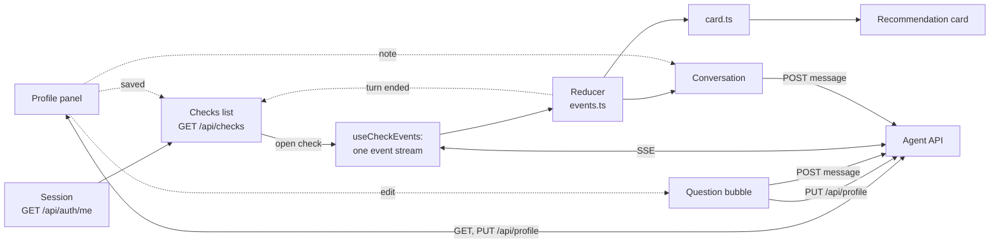

# The page

How the page shows a conversation and its recommendation, and how the agent serves it. It is the
React app in `frontend/`: Hebrew, right to left, in TypeScript, built with Vite. It reads the
agent's HTTP API ([the agent](agent.md)) and holds no data the agent does not hold; the layers
and the other parts are in [the architecture map](../architecture.md), the sign-in in
[sign-in.md](../sign-in.md).

**Contents:** [Layout](#layout) · [Data flow](#data-flow) ·
[The question bubble](#the-question-bubble) · [The card](#the-card) ·
[Refreshing the checks list](#refreshing-the-checks-list) ·
[Deleting a check](#deleting-a-check) · [Serving](#serving)

## Layout

A signed-out visitor sees the product name and the "התחברות עם Google" button
(`frontend/src/auth/`), which sends the browser to Google and receives the ID token back in the URL
fragment ([sign-in.md](../sign-in.md)). Under the name a line gives the build: its
version, which is the release tag the checkout descends from (`vMAJOR.MINOR`) and the commits since
it, and its last commit's date. `scripts/lib/build-info.sh` reads both from git and the image
build receives them as build arguments, since its context has no `.git`. Under the card, one
line of links opens the demo, whose tooltip says it is a recorded check best seen on a computer; a
WhatsApp invite carrying the page's own address; and the GitHub source.

A signed-in person sees a header whose account menu (`shell/AccountMenu.tsx`) names the account and
holds sign-out, and one open check. The open check is kept in the URL hash as `#check=<id>`; a hash
that names no check of theirs opens the newest one and is rewritten to match.

The demo, `/demo.html`, is the same app over a recorded check (`frontend/src/demo/`). Before the
app renders, it replaces `fetch` and `EventSource` with a backend that replays one check's stored
events on a timer. It types each reply out as deltas, since the server stores replies whole. Before
each message the person typed, it shows the typed value in its box for a second: an answer in its
question's box, any other message in the chat's composer. It answers the profile and the checks
list from the events played so far. `sql-helper.sh --demo-check <id>` writes the recording from
the stack's database.

From 900px wide the open check is three columns: the side column (the checks list, whose
entry for each check names its goal, then the shared profile panel), the conversation, and the
recommendation card. The card starts at its narrowest, 380px; dragging the border between it and
the conversation, or the arrow keys on that border, widens it up to what leaves room for the side
column and a readable conversation (`check/CardResizer.tsx`), and the browser keeps the width.
Below 900px a tab bar shows one of the three at a time (`frontend/src/styles/global.css`).

## Data flow

The page asks for the session first. With a session it loads the checks list, newest first, and
opens one. `useCheckEvents` opens one event stream (`/api/checks/<id>/events`) for the open check
and closes it when another check opens. The stream replays the check's stored events and then
continues live; the browser reconnects by itself and the agent replays only what followed. The
reducer (`check/events.ts`) folds each event into one state: the messages, the options by id,
the latest recommendation and goal, how many profile updates arrived, and whether a turn is
running. A `question.asked` event becomes a question entry in the messages, and a `chart.shown`
event a chart entry, which `check/MarketChart.tsx` draws as a line (the prime) or as bars around
zero (the CPI's monthly change), with a hidden table of the values for screen readers.
The question is live while it is the last entry and no turn runs. Only the person's next message
closes it; a running turn hides its controls until the turn ends. A closed question stays in the
conversation as text.
Stored events carry a sequence number and are applied once; a partial reply (`message.delta`)
carries the whole reply so far and is dropped when its complete message has already arrived. The
conversation and the card both render from that state. A 401 on any call returns the page to
sign-in. The browser retries a dropped stream by itself but closes it for good on a response it
will not retry; the page treats any such close, a 401 among them, as signed out.

The profile is not part of the stream. `profile/profileStore.ts` holds it as one store per
open check, which the profile panel and the question bubble share. The store reads
`GET /api/profile` and writes `PUT /api/profile`. The profile is shared by all checks, while a
check's stream replays the profiles of that check's history, so the store never shows a profile
taken from an event: a `profile.updated` is only a signal to read the profile again. The store
reads it once on opening, which covers the updates replayed meanwhile, and again each time the
count of updates grows past what its last read covered. Reads and saves are numbered together
when sent, so an answer that arrives after a later one is dropped.

The panel saves a figure when its field loses focus, and a value equal to the stored one sends
nothing. The panel's fields start folded, and only the person unfolds them, so the conversation
keeps the focus. A save that comes from the chat, or a re-read triggered by a profile update,
flashes the fields that changed for a moment when the panel is open.

## The question bubble

When the model asks a question, `check/QuestionBubble.tsx` renders it as an assistant bubble with
the lead-in and the field's label. While the question is live it also shows a hint, a control fitted
to the field (a text box for an amount, tap choices for a purpose), a confirm button for typed
answers and a skip button. A question with choices of its own (the purpose, a free question the
model gave choices, or the clone offer) has no skip, since the chat box takes any other answer
and a skip only gets the question asked again. A closed question shows only the text.

`check/CheckPage.tsx` handles the answer in this order. A tapped or typed answer to a profile
field is saved through the store (`PUT /api/profile`), the checks list is refreshed, and then the
page-built line "<label>: <value>" is posted as the person's own message; a label that ends in
"?" takes its value after a space instead. A refused save shows its message in the bubble and
sends nothing. An answer to a goal field or a free question posts the line alone, with no save.
A skip posts "דילוג על: <label>" without a save, except for variable income, its minimum,
existing loan payments and savings: the calculation cannot go on without them and "none" is a
common answer, so their skip saves 0 and posts "דילוג על: <label> (נשמר כ-0)". The agent's
side of the question is in
[the agent](agent.md).

A panel edit while a question is live goes one of two ways. An edit of the field the question
asks for is sent as that question's answer, with the same line. Any other edit adds a note to the
conversation, "עודכן בפרופיל: <label> <value>", which the page holds for this tab only: it is not
stored and does not reach the agent. The note is also added when the answer sent for the live
question is not accepted.

Money is never a JavaScript number. The API sends amounts as decimal strings, and
`frontend/src/money.ts` formats them from the text, rounding half up on the digits.

## The card

Every figure on the recommendation card comes from the check's stored engine results; none comes
from the model's text. `check/card.ts` maps the state to a model the card renders, and
`check/copy.ts` holds each Hebrew sentence.

| On the card | Comes from |
|---|---|
| Decision sentence: loan amount, term, today's payment, savings kept as the cushion, and spare savings when any | The recommendation's sizing; the term and today's payment from the preferred option |
| Track line and source (published average, or a lender and date) | The option's loan and source |
| Filled chip "דוגמא", a dashed outline and one line above the options | The option's source is the published average, so nobody can take it |
| Green chip "התשלום לא ישתנה" | The option has no worst-case payment: the payment cannot move |
| Amber chip: the worst-case payment and its period | The option's worst peak payment and the start and end of its worst window |
| Balloon line | The option's balloon due |
| Ceiling and its reasons | The recommendation's bounds; each reason code has one sentence |
| Cushion | The recommendation's minimum cushion |
| Total cost today, and the range across history | The option's total paid, and the range of its simulation's historical windows with their count |
| Data dates and assumptions | The dates the option's figures rest on |

A reason code with no sentence, a recommended option missing from the saved options, or an amber
chip without a worst window throws, so a card never shows a quietly wrong figure. An error
boundary around the card pane (`check/CardBoundary.tsx`) logs the throw and shows "לא הצלחנו
להציג את ההמלצה." in the pane, while the conversation and the profile keep working.

**Options after the latest recommendation.** The reducer keeps the ids of options saved after the
latest recommendation that it does not name. The card lists the recommended and alternative
options first. The remaining options form one group, titled "הצעות חדשות, עוד לא נכללו בהמלצה"
when every one of them was saved after the latest recommendation and "הצעות נוספות" when any is
older. Before any recommendation every option sits in that group under "האפשרויות שנבדקו", and
the card has no decision sentence.

**The fold.** "למה המספרים האלה" is open when the card first renders and the person may close it.
It holds the ceiling with its reasons, the cushion, a table of total cost today and the range
across history for each listed option, and the assumptions.

**The stale banner.** The checks list marks a check whose recommendation was computed from a
profile the person has since changed. The open check then shows a banner over the card with a
"לחשב מחדש" button. No recompute route exists: the button sends the person's own message, a fixed
Hebrew sentence asking the assistant to recompute from the updated numbers, through the same send
as the input. The button is disabled while a turn runs.

**The cap.** When the agent refuses a message because the turn cap is reached (429), the page
keeps the typed text and shows when the next message is allowed, in the viewer's local time. The
cap counts a rolling window, so the notice gives the time alone for today, "tomorrow" with the
time, or the date and time when it is later. Any other refusal shows its message; a 409, a turn
already running, shows nothing. A message the page shows is Hebrew: a server-given detail text
passes through, while an English validation list or an answer without a detail becomes a Hebrew
sentence of the page's own, and the English is logged with `console.error`.

**A reply cut short.** A reply still streaming when its turn goes idle was never stored, so the
reducer drops it, as a reload would. A screen reader hears each reply once, when it is complete:
a visually hidden live region carries the latest complete reply, not the log itself.

**Following the conversation.** The conversation scrolls to its end as messages and streamed text
arrive, unless the person has scrolled up; it follows again when they return to the end.

## Refreshing the checks list

The list shows each check's purpose, price, whether it has a recommendation, a "דוגמא" chip when
that recommendation names only examples, and whether it is stale, so a turn can change it. The page
loads it on start and after it creates a check. It refetches it when a turn this page started has
ended, and after a profile save. The reducer counts a turn end when a running turn goes idle. The
page records that count when a send is accepted and refetches once when the count passes it, so the
replay of old turns on opening a check, and a turn another tab started, change nothing. Refetches
are numbered when sent, and an answer older than one already applied is dropped.

## Deleting a check

Each entry in the checks list has a delete icon, which first asks for confirmation beside the
entry, with focus on the cancel button, because a delete cannot be undone. A confirmed delete calls
`DELETE /api/checks/<id>` and refreshes the list. Deleting the open check opens the newest one
left; with none left the page shows a centred card with the button for a new check. A delete during
a reply is refused with a sentence asking to try again in a moment.

## Serving

The agent serves the built page. When `AGENT_FRONTEND_DIST` names a folder, `_mount_frontend` in
`platform/app.py` mounts it at `/` after the API routers, so API paths win, and refuses to start
when the folder has no `index.html`. The page and the API share one origin, which the sign-in
cookie needs ([sign-in.md](../sign-in.md)).

`backend/Dockerfile` has a Node stage that installs the lockfile and runs the build, and copies
the result into the agent image at `/app/frontend`, where `ENV AGENT_FRONTEND_DIST` points;
compose does not pass the key from the settings files, so a host path there cannot replace the
image's copy. An agent started on the host sets it in `scripts/lib/stack-params.sh` to
`frontend/dist`, or leaves it unset to serve the API only.

In development `npm run dev` in `frontend/` starts Vite, which proxies `/api` to the agent at
`http://localhost:8101` (`frontend/vite.config.ts`). The page is then at
`http://localhost:5173`, which Google sign-in needs as a second authorized redirect URI
(`http://localhost:5173/`)
([sign-in.md](../sign-in.md)).
