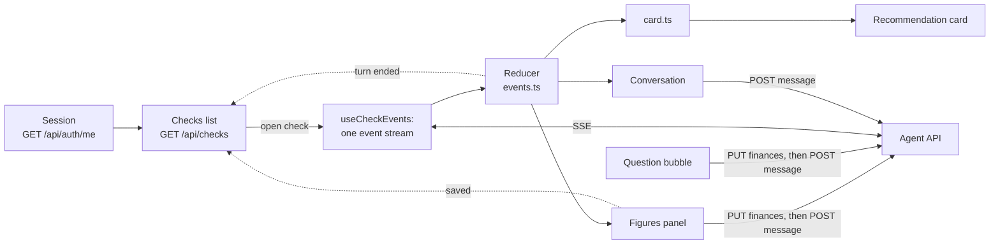

# The page

How the page shows a conversation and its recommendation, and how the agent serves it. It is the
React app in `frontend/`: Hebrew, right to left, in TypeScript, built with Vite. It reads the
agent's HTTP API ([the agent](agent.md)) and holds no data the agent does not hold; the layers
and the other parts are in [the architecture map](../architecture.md), the sign-in in
[sign-in.md](../sign-in.md).

**Contents:** [Layout](#layout) · [Data flow](#data-flow) ·
[The question bubble](#the-question-bubble) · [The card](#the-card) ·
[Refreshing the checks list](#refreshing-the-checks-list) ·
[Archiving and deleting a check](#archiving-and-deleting-a-check) · [Serving](#serving)

## Layout

A signed-out visitor sees the product name and the "התחברות עם Google" button
(`frontend/src/auth/`), which sends the browser to Google and receives the ID token back in the URL
fragment ([sign-in.md](../sign-in.md)). Under the name a line gives the build: its
version, which is the release tag the checkout descends from (`vMAJOR.MINOR`) and the commits since
it, and its last commit's date. `scripts/lib/build-info.sh` reads both from git and the image
build receives them as build arguments, since its context has no `.git`. Under the card, one
line of links opens the demo, whose tooltip says it is a recorded check best seen on a computer; a
WhatsApp invite carrying the page's own address; and the GitHub source.

A signed-in person sees a header whose account menu (`shell/AccountMenu.tsx`) names the account and
holds sign-out, and one open check. The open check is kept in the URL hash as `#check=<id>`; a hash
that names no check of theirs opens the newest one and is rewritten to match.

The demo, `/demo.html`, is the same app over a recorded check (`frontend/src/demo/`). Before the
app renders, it replaces `fetch` and `EventSource` with a backend that replays one check's stored
events on a timer. It types each reply out as deltas, since the server stores replies whole. Before
each message the person typed, it shows the typed value in its box for a second: an answer in its
question's box, any other message in the chat's composer. It answers the checks list from the
events played so far. A recorded clone names the last event it shares with its source, and the
demo rebuilds the source from those shared events and its clone note: once the replay passes the
clone, the list shows both, and the source opens on its whole conversation.
`sql-helper.sh --demo-check <id>` writes the recording from the stack's database.

From 900px wide the open check is three columns: the side column (the checks list), the
conversation, and the recommendation card. Once the check has figures (its income and fixed
expenses), a one-line summary of them sits above the conversation, with an "עריכה" link that opens
the two fields in place. The side column is 300px, so an entry's title fits its first line and its
term its second. The card starts at 470px; dragging the border between it and the conversation, or
the arrow keys on that border, narrows it to 380px or widens it up to what leaves the conversation
360px (`check/CardResizer.tsx`), and the browser keeps the width. The conversation takes the rest.
Below 900px a tab bar ("בדיקות", "שיחה", "המלצה") shows one of the three at a time
(`frontend/src/styles/global.css`).

## Data flow

The page asks for the session first. With a session it loads the checks list, newest first, and
opens one. `useCheckEvents` opens one event stream (`/api/checks/<id>/events`) for the open check
and closes it when another check opens. The stream replays the check's stored events and then
continues live; the browser reconnects by itself and the agent replays only what followed. The
reducer (`check/events.ts`) folds each event into one state: the messages, the options by id, the
latest recommendation, the loan, the confirmed term, the ceiling with its source, the check's two
finances figures, and whether a turn is running. A `question.asked` event becomes a question entry
in the messages, and a `chart.shown` event a chart entry, which `check/MarketChart.tsx` draws as a
line (the prime) or as bars around zero (the CPI's monthly change), with a hidden table of the
values for screen readers. The question is live while it is the last entry and no turn runs. Only
the person's next message closes it; a running turn hides its controls until the turn ends. A closed
question stays in the conversation as text. Stored events carry a sequence number and are applied
once; a partial reply (`message.delta`) carries the whole reply so far and is dropped when its
complete message has already arrived, and `message.retracted` removes a partial reply the
assistant is rewriting. The conversation and the card both render from that state. A
401 on any call returns the page to sign-in. The browser retries a dropped stream by itself but
closes it for good on a response it will not retry; the page treats any such close, a 401 among
them, as signed out.

The figures belong to the check, so they come with its stream: each `finances.updated` carries
both figures and the ceiling after the save, and the figures panel (`check/FinancesPanel.tsx`)
renders from the reducer's state. It shows net fixed income and fixed expenses, each with its
hint, and the check's ceiling with its source when there is one. It starts closed, and only the
person opens it, so the conversation keeps the focus. A figure is saved when its field loses
focus, and a value equal to the stored one sends nothing. The save is
`PUT /api/checks/<id>/finances`, then the page posts "עודכן: <label> <value>" as the person's
own message, so the agent explains the ceiling the figures give. A refused save shows its message
under the field and sends nothing. While a turn runs, or once the check is archived, the fields
show but take no edit.

## The question bubble

When the model asks a question, `check/QuestionBubble.tsx` renders it as an assistant bubble with
the lead-in and the field's label. While the question is live it also shows a hint, a control fitted
to the field (a text box for an amount, tap choices for a purpose), a confirm button for typed
answers and a skip button. The ceiling question also has a "לא יודע/ת" button, which sends those
words, and the agent takes them as a request for help: it asks for the two finances figures
instead. A question with choices of its own
(the purpose, a free question the model gave choices, or the clone offer) has no skip, since the
chat box takes any other answer and a skip only gets the question asked again. A closed question
shows only the text.

The term card is a question of its own kind: one line with the proposed term in months and its first
payment, then one form with two boxes and one "אישור" button. The term box starts at the proposed
term; the ceiling box starts at the check's payment ceiling, or empty when it has none. On אישור:

- A new ceiling with the term left as proposed goes with its line to
  `POST /api/checks/<id>/term-ceiling`; the agent saves it as the stated ceiling and answers with a
  card worked out from it, with no model call: the shortest term whose worst-case payment fits the
  ceiling, or 84 months.
- Anything else confirms the term in the box. The page saves it, with a new ceiling when there is
  one (`PUT /api/checks/<id>/term`), and sends "אישור: 48 חודשים", or "אישור: 48 חודשים, החזר
  חודשי מרבי: 1,000 ₪", so the model reads both as set rather than judging the line.

A term outside 6 to 84 months, or a ceiling the check holds cleared from its box, is refused in
the bubble. The card's own term typed in the chat ("60" or "60 חודשים") while the card is open
confirms it too; another number typed there goes to the model, which answers with a card for it.

`check/CheckPage.tsx` handles the answer in this order. A typed answer to a finances field is
saved first (`PUT /api/checks/<id>/finances`), the checks list is refreshed, and then the
page-built line "<label>: <value>" is posted as the person's own message; a label that ends in
"?" takes its value after a space instead. A refused save shows its message in the bubble and
sends nothing. An answer to a loan or ceiling field or a free question posts the line alone, and
the agent saves it with its own tool. A skip posts "דילוג על: <label>" without a save. The
agent's side of the question is in [the agent](agent.md).

Money is never a JavaScript number. The API sends amounts as decimal strings, and
`frontend/src/money.ts` formats them from the text, rounding half up on the digits.

## The card

Every figure on the recommendation card comes from the check's stored engine results; none comes
from the model's text. `check/card.ts` maps the state to a model the card renders, and
`check/copy.ts` holds each Hebrew sentence.

| On the card | Comes from |
|---|---|
| Decision sentence: loan amount, term and today's payment | The recommendation's loan amount; the term and today's payment from the preferred option |
| The check line under it: unchecked, or above the ceiling with both payments | The recommendation's ceiling, or none, and the preferred option's worst-case payment against the ceiling the check holds now |
| Ceiling line: the amount and its source | The check's ceiling, from `ceiling.set` or `finances.updated`; absent while the check has none |
| Track line and source (published average, or a lender and date) | The option's loan and source |
| Filled chip "דוגמא", a dashed outline and one line above the options | The option's source is the published average, so nobody can take it |
| Green chip "התשלום לא ישתנה" | The option has no worst-case payment: the payment cannot move |
| Amber chip: the worst-case payment and its period | The option's worst peak payment and the start and end of its worst window |
| Balloon line | The option's balloon due |
| Total cost today, and the range across history | The option's total paid, and the range of its simulation's historical windows with their count |
| Data dates and assumptions | The dates the option's figures rest on |

**The check line.** A recommendation is in one of three states. Made while the check had no
ceiling, it is unchecked, and the card says so: "ההמלצה לפי ההלוואות עצמן; עוד לא נבדקה מול ההחזר
שנוח לך", with the ceiling line "החזר חודשי מרבי: לא נקבע". Made against a ceiling, it fits,
and the card shows the ceiling line alone, with the ceiling and its source. When the
preferred option's worst-case payment is above the ceiling the check holds now, for instance just
after the person gave one, the card marks it above, "מעל התקרה שלך: <worst> מול <ceiling>", until
the agent recommends again.

A recommended option missing from the saved options, or an amber chip without a worst window,
throws, so a card never shows a quietly wrong figure. An error boundary around the card pane
(`check/CardBoundary.tsx`) logs the throw and shows "לא הצלחנו להציג את ההמלצה." in the pane,
while the conversation and the figures panel keep working.

**Options after the latest recommendation.** The reducer keeps the ids of options saved after the
latest recommendation that it does not name. The card lists the recommended and alternative
options first. The remaining options form one group, real offers before samples and each
cheapest in total first, titled "הצעות חדשות, עוד לא נכללו בהמלצה"
when every one of them was saved after the latest recommendation and "אפשרויות נוספות" when any
is older. Before any recommendation every option sits in that group under "האפשרויות שנבדקו", and
the card has no decision sentence. The group leaves out a sample made for a term other than the
check's confirmed one: after the term changes, in the check or in its clone, the old samples
measure nothing the person is deciding. A real offer stays, since it carries its lender's term.

**The fold.** "למה המספרים האלה" is open when the card first renders and the person may close it.
It holds a table of total cost today and the range across history for each listed option, and
the assumptions.

**The cap.** When the agent refuses a message because the turn cap is reached (429), the page
keeps the typed text and shows when the next message is allowed, in the viewer's local time. The
cap counts a rolling window, so the notice gives the time alone for today, "tomorrow" with the
time, or the date and time when it is later. Any other refusal shows its message; a 409, a turn
already running, shows nothing. A message the page shows is Hebrew: a server-given detail text
passes through, while an English validation list or an answer without a detail becomes a Hebrew
sentence of the page's own, and the English is logged with `console.error`.

**A reply cut short.** A reply still streaming when its turn goes idle was never stored, so the
reducer drops it, as a reload would. A screen reader hears each reply once, when it is complete:
a visually hidden live region carries the latest complete reply, not the log itself.

**Following the conversation.** The conversation scrolls to its end as messages and streamed text
arrive, unless the person has scrolled up; it follows again when they return to the end.

## Refreshing the checks list

The list titles each check by its loan, "<purpose> - הלוואה בסך <amount>₪", with "כללי" for a loan
with no purpose and "בדיקה חדשה" before the loan is known. It marks whether the check has a
recommendation, with a "דוגמא" chip when that recommendation names only examples, and whether it is
archived, so a turn can change it. The page loads it on start and after it creates a check. It
refetches it when a turn this page started has ended, and after a finances save. The reducer counts
a turn end when a running turn goes idle. The page records that count when a send is accepted and
refetches once when the count passes it, so the replay of old turns on opening a check, and a turn
another tab started, change nothing. A turn the page did not start, such as a clone's first turn,
which the shell sends before it opens the clone, is caught by a second rule: once the stream has
events and no turn runs, a list entry whose loan, term or recommendation differs from the check's
own events is refetched. Refetches are numbered when sent, and an answer older than one already
applied is dropped.

## Archiving and deleting a check

An entry in the checks list the person has sent a message to (the list's `started` flag) has a
duplicate icon, which clones the check beside it, and when live an archive icon; a check holding
only the opening line has neither, since it has nothing to copy or keep. An entry shows its loan as
its title and, once confirmed, its term on a second line. A clone, from the icon or the clone offer,
adds a handoff note to the source's conversation ("הבדיקה שוכפלה לבדיקה נפרדת.") with a button to
the copy; the source stays open. The clone offer's choice sends the copy its first line with the
request that brought the offer ("לשכפל ולבדוק בנפרד: ננסה עם 24"), so the copy carries out that
request rather than reading it back from the copied conversation. Archived checks follow the live
ones in a group of their own, folded until the person opens it, and an archived check is read-only,
with a note closing its conversation. Archiving the open check opens the newest live check in its
place, or a new check when none is left, so the open check is never one hidden in the folded group.
An archived check has a restore icon and a delete icon, so a delete is always a second step. The
delete icon first asks for confirmation beside the entry, with focus on the cancel button, because a
delete cannot be undone. A confirmed delete calls `DELETE /api/checks/<id>` and refreshes the list.
Deleting the open check opens the newest one left; with none left the page shows a centred card with
the button for a new check. A delete during a reply is refused with a sentence asking to try again
in a moment.

## Serving

The agent serves the built page. When `AGENT_FRONTEND_DIST` names a folder, `_mount_frontend` in
`platform/app.py` mounts it at `/` after the API routers, so API paths win, and refuses to start
when the folder has no `index.html`. Its HTML goes out with `Cache-Control: no-cache`, so the
first load after a deploy runs the new build; the other files carry a content hash in their
names, so a cached copy is never stale. The page and the API share one origin, which the sign-in
cookie needs ([sign-in.md](../sign-in.md)).

`backend/Dockerfile` has a Node stage that installs the lockfile and runs the build, and copies
the result into the agent image at `/app/frontend`, where `ENV AGENT_FRONTEND_DIST` points;
compose does not pass the key from the settings files, so a host path there cannot replace the
image's copy. An agent started on the host sets it in `scripts/lib/stack-params.sh` to
`frontend/dist`, or leaves it unset to serve the API only.

In development `npm run dev` in `frontend/` starts Vite, which proxies `/api` to the agent at
`http://localhost:8101` (`frontend/vite.config.ts`). The page is then at
`http://localhost:5173`, which Google sign-in needs as a second authorized redirect URI
(`http://localhost:5173/`)
([sign-in.md](../sign-in.md)).
