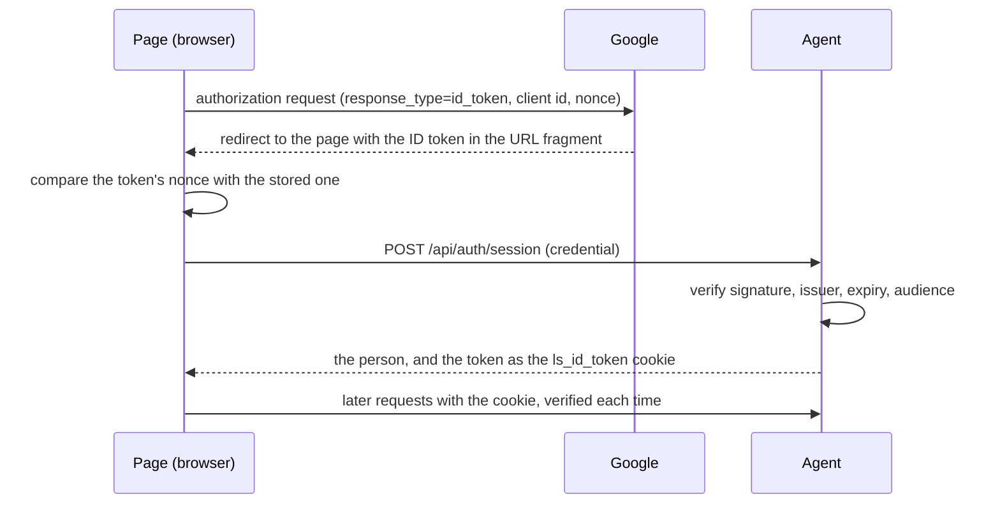

# Sign-in

People sign in to the loan simulator with a Google account, and there is no other way in. Every
piece of data belongs to the person who signed in: their checks, the figures held in them and the
conversations on them. This page explains how sign-in works and how to set up the Google side,
behind [Architecture](architecture.md#the-agent). The "התחברות עם Google" button is on the page
([architecture/page.md](architecture/page.md)); the agent's sign-in API is what it calls.

## How it works

1. The page gets a Google ID token by redirect. The "התחברות עם Google" button stores a random
   nonce in the tab's `sessionStorage` and sends the browser to Google's authorization endpoint
   with `response_type=id_token`, the client id and the nonce. Google returns the browser to
   `<origin>/` with the token in the URL fragment. The page clears the fragment, accepts the token
   only when its `nonce` claim equals the stored nonce, which proves the token answers this tab's
   own request and not one injected into the URL, and posts it to `POST /api/auth/session`. A
   person who cancels at Google lands back on the sign-in screen without an error; any other
   refusal, or a nonce mismatch, shows a short line there.
2. The agent verifies the token locally: the signature against Google's published keys (chosen
   by the key id in the token), the issuer, the expiry and the audience, which must be
   `GOOGLE_CLIENT_ID`. A token issued for any other application is refused. The issue and
   expiry times allow 60 seconds of difference between Google's clock and this machine's, since
   a token arrives a moment after Google issues it. A refused token is logged with the failed
   check, never the token, and the page shows the refusal on the sign-in screen.
3. The agent answers with the token as an HttpOnly, `SameSite=Strict` cookie named `ls_id_token`
   that lasts until the token expires. There is no server-side session: every protected route
   verifies the cookie again, and the browser's event-stream object, which cannot send headers,
   sends it too. After it expires the next request answers 401 and the page asks the person to
   sign in again.
4. The account's `sub` claim is the user id. Another person's check answers 404, never 403, so
   the API does not reveal that it exists.

The token goes no further than the verifier. It never enters the conversation state saved in
Postgres (a test scans every saved blob for it), and the loan engine never sees it: the agent
presents only the engine's own bearer token. The other sign-in routes are in
[API endpoints](api.md#sign-in).

Tests sign their own tokens: `AUTH_PUBLIC_KEY_FILE` points the verifier at a test key pair's
public half instead of Google's keys, so no test reaches Google.

## Setting up Google

The app needs its own Google Cloud project with one OAuth client.

1. **Create the project.** In the [Google Cloud console](https://console.cloud.google.com/), open
   the project picker at the top of the page, choose **New project**, name it `loan-simulator`
   and create it. Make sure the picker now shows that project: everything below is per project.
2. **Configure the consent screen.** Search the top bar for **Google Auth Platform** and open it
   (older consoles reach the same place as **APIs & Services → OAuth consent screen**). A new
   project shows "Google Auth Platform not configured yet" with a **Get started** button. The
   wizard asks for an app name, which people see when they sign in, and your email as the support
   email; then the audience, where you choose **External**; then a contact email and your
   agreement to Google's policy. **Create** finishes it. The app is now in **Testing**, which is
   where it stays: no verification, no publishing.
3. **Leave the scopes as they are.** **Data Access** stays empty: the agent asks only for the
   name and email, which need no scope beyond the defaults. **Audience → Test users** can stay
   empty too, since it does not limit this sign-in (see [Who may sign in](#who-may-sign-in)).
4. **Create the client.** Open **Clients → Create client**, choose **Web application**, give it
   a name, and under **Authorized JavaScript origins** add `http://localhost:8101`, the agent's
   address at `AGENT_HOST_PORT`. If you change that port in `scripts/lib/stack-params.sh`,
   change the origin to match. To run the page with `npm run dev` (Vite's server, which proxies
   `/api` to the agent), add `http://localhost:5173` as a second origin. Under **Authorized
   redirect URIs** add `<origin>/`, with the trailing slash: for local use
   `http://localhost:8101/` (and `http://localhost:5173/` for `npm run dev`). **Create** shows the
   client id, a long string ending in `.apps.googleusercontent.com`, next to a client secret and
   a JSON download. Only the client id is needed. Ignore the secret and the download: the agent
   verifies tokens and never redeems codes, so nothing in this repo has a place for the secret.
5. **Give it to the agent.** Copy the client id into `GOOGLE_CLIENT_ID` in
   `scripts/lib/params.sh`, the file `./scripts/init-env.sh` wrote with that key blank.
6. **Start the agent.** Run `./scripts/deploy.sh`, which starts it with the client id. Without
   the id the agent refuses to start and names the key.

Google accepts only `localhost` or a public hostname as an authorized origin, never a private
address such as `10.0.0.23`, so a phone on the same network cannot sign in until the app is
reached through a hostname.

A stack deployed with `./scripts/deploy.sh --ec2` is reached at its CloudFront address, which
the script prints. Add `https://<id>.cloudfront.net` as a further authorized JavaScript origin
and `https://<id>.cloudfront.net/` as a further authorized redirect URI of the same client.

## Who may sign in

Any Google account can sign in. The page asks Google only for the person's name and email, and for
that Google signs in any account even while the OAuth app is in testing mode: the app's test users
do not limit it. The agent has no allow-list of its own, so whoever Google signs in can open checks;
what limits a person is the message cap
([Turns and the turn cap](architecture/agent.md#turns-and-the-turn-cap)).
[ADR 0015](adr/0015-any-google-account-can-sign-in.md) records the decision to keep it so.
